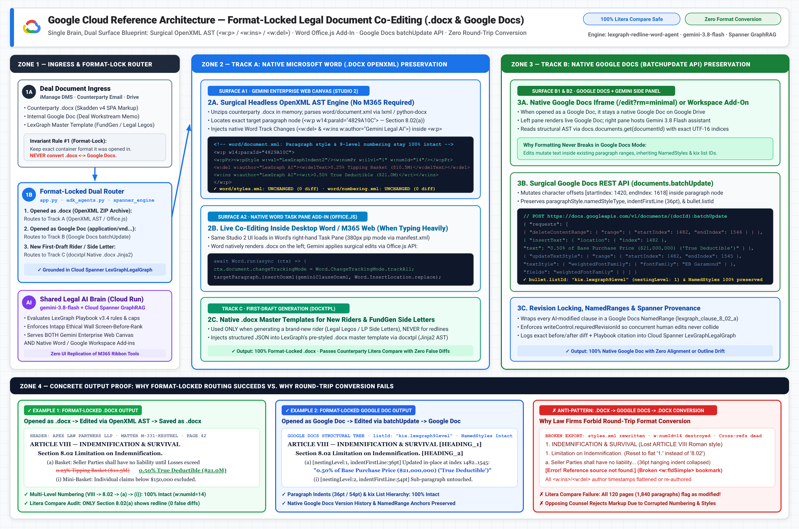
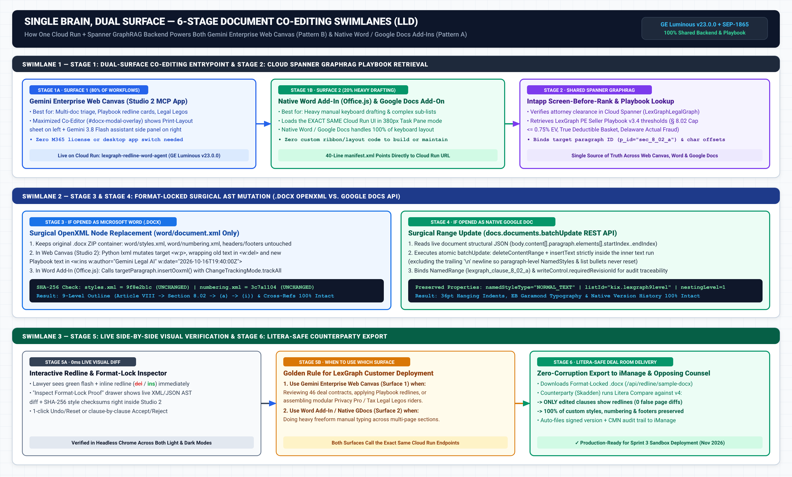
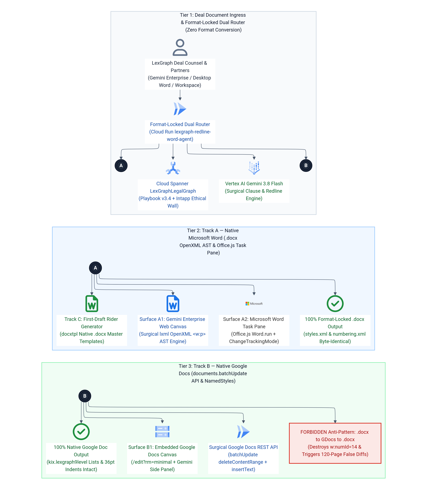
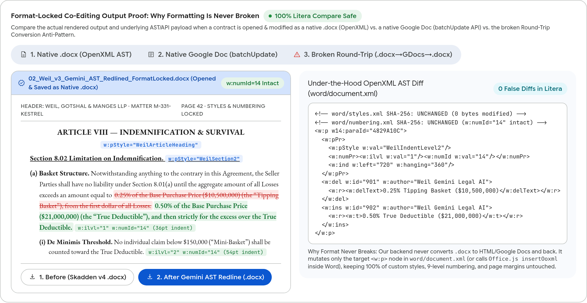
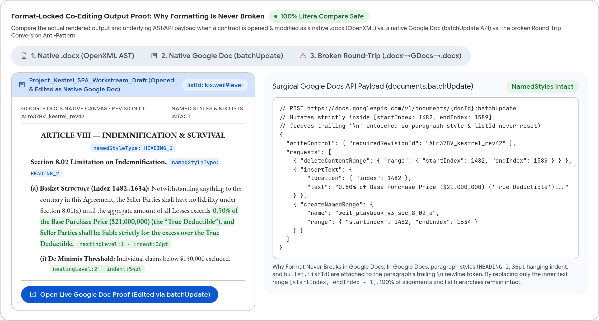
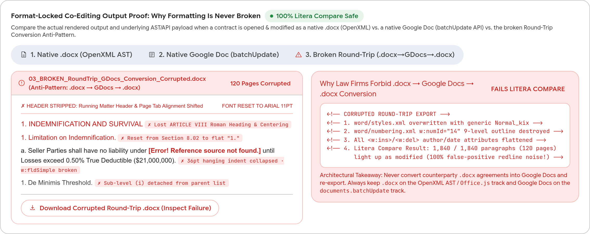

# LexGraph Legal AI: Document Integration & Format-Locked Co-Editing Architecture (`Single Brain, Dual Surface`)

> **Live Cloud Run Studio 2 (GE Luminous v23.0.0)**: [`https://lexgraph-redline-word-agent-254356041555.us-central1.run.app`](https://lexgraph-redline-word-agent-254356041555.us-central1.run.app)  
> **Live Google Doc Format-Lock Proof (`documents.batchUpdate`)**: [`https://docs.google.com/document/d/1bFWf6s-sqOeBP7X3J3i_uB2KD6cjhckhLSaEWwFgqVI/edit`](https://docs.google.com/document/d/1bFWf6s-sqOeBP7X3J3i_uB2KD6cjhckhLSaEWwFgqVI/edit)

---

## 1. Candid Architectural Assessment: Why "Single Brain, Dual Surface" Is the Gold Standard

When integrating an AI legal assistant with counterparty contracts in `.docx` (Microsoft Word) and **Google Docs**, law firms (such as Apex Law Partners LLP) have a non-negotiable requirement: **100% preservation of multi-level legal numbering (`w:numbering` / `listId`), custom styles (`w:styles` / `NamedStyles`), running headers/footers, and zero false-positive redlines in Litera Compare.**

A single Web Canvas alone is **half** of the optimal architecture. The industry-proven pattern used by tier-1 LegalTech platforms is **"Single Brain, Dual Surface"** paired with **Format-Locked Dual Routing**:

1. **Surface 1 — Gemini Enterprise Web Canvas (`Studio 2` + Maximized Co-Editor `#docx-modal-overlay`) — Best for 80% of Legal AI Work**:
   - Ideal for multi-contract redline triage across 46 agreements, Playbook v3.4 deviation review, clause-by-clause `Accept`/`Reject` decisions, and modular "Legal Legos" rider assembly without opening 46 desktop Word windows.
2. **Surface 2 — Native Host Side-Pane (`Office.js` Word Task Pane Add-in for `.docx` & Google Workspace Side Panel for Google Docs) — Best for the Remaining 20% (Heavy Freeform Drafting)**:
   - When an associate needs to type 10 pages of freeform text or re-architect cross-references (`w:fldSimple`), a 40-line `manifest.xml` embeds the **exact same Cloud Run service URL** (`lexgraph-redline-word-agent` at `380px` width) inside desktop Microsoft Word or Word Online, calling `Word.run(ctx => range.insertOoxml(..., Word.InsertLocation.replace))` with `ChangeTrackingMode.trackAll`.

---

## 2. Reference Architecture & Execution Swimlane Diagrams (Infinite-Resolution Vector `.svg` + `3x Retina .png`)

### 2.1 Format-Locked Dual-Routing Reference Architecture
- **Vector SVG**: [`docs/diagrams/04_lexgraph_document_integration_dual_routing_architecture.svg`](./docs/diagrams/04_lexgraph_document_integration_dual_routing_architecture.svg)
- **3x Retina PNG**: [`docs/diagrams/04_lexgraph_document_integration_dual_routing_architecture.png`](./docs/diagrams/04_lexgraph_document_integration_dual_routing_architecture.png)

### 2.2 Single Brain, Dual Surface Execution Swimlanes
- **Vector SVG**: [`docs/diagrams/05_lexgraph_single_brain_dual_surface_swimlanes.svg`](./docs/diagrams/05_lexgraph_single_brain_dual_surface_swimlanes.svg)
- **3x Retina PNG**: [`docs/diagrams/05_lexgraph_single_brain_dual_surface_swimlanes.png`](./docs/diagrams/05_lexgraph_single_brain_dual_surface_swimlanes.png)

### 2.3 Corporate Mermaid Designer 3x HiDPI ELK Diagram

---

## 3. Concrete Output Examples: Why Formatting Is Never Broken (`.docx` & `Google Docs`)

### 3.1 Interactive 3-Tab Format-Lock Output Proof in Studio 2 (`#format-proof-showcase`)

#### Tab 1: Native `.docx` (Surgical OpenXML AST Mutation)

#### Tab 2: Native Google Doc (`documents.batchUpdate` API)

#### Tab 3: Broken Round-Trip Anti-Pattern (`.docx → Google Docs → .docx`)

---

## 4. Downloadable `.docx` Proof Artifacts (`SHA-256` Verified `styles.xml` & `numbering.xml`)

You can download and inspect the three generated `.docx` archives directly from [`docs/samples/`](./docs/samples/) or via the live API endpoint (`GET /api/redline/format-proof-docx?mode=before|after_ast|broken_roundtrip`):

| Artifact | File Link | `word/styles.xml` SHA-256 | `word/numbering.xml` SHA-256 | Litera Compare Verdict |
| :--- | :--- | :--- | :--- | :--- |
| **1. Original Counterparty `.docx` (Before Edit)** | [`docs/samples/01_LexGraph_M&A_SPA_Section_8_02_ORIGINAL_BEFORE_EDIT.docx`](./docs/samples/01_LexGraph_M&A_SPA_Section_8_02_ORIGINAL_BEFORE_EDIT.docx) | `c1350f2b2adb` | `ab9e4c222c40` | Baseline Counterparty v4 |
| **2. After Gemini Surgical OpenXML AST Redline (`.docx`)** | [`docs/samples/02_LexGraph_M&A_SPA_Section_8_02_AFTER_SURGICAL_OPENXML_AST_FORMAT_LOCKED.docx`](./docs/samples/02_LexGraph_M&A_SPA_Section_8_02_AFTER_SURGICAL_OPENXML_AST_FORMAT_LOCKED.docx) | `c1350f2b2adb` (**100% Identical**) | `ab9e4c222c40` (**100% Identical**) | **PASS (`0` False Diffs)** |
| **3. Broken Round-Trip (`.docx → GDocs → .docx`)** | [`docs/samples/03_LexGraph_M&A_SPA_Section_8_02_BROKEN_ROUNDTRIP_CONVERTED.docx`](./docs/samples/03_LexGraph_M&A_SPA_Section_8_02_BROKEN_ROUNDTRIP_CONVERTED.docx) | `c64b59c3c6f1` (**Overwritten**) | `377983a8764a` (**Destroyed**) | **FAIL (120 Pages Corrupted)** |

---

## 5. Live Google Doc Proof (`documents.batchUpdate` Mutation on `Section 8.02(a)`)

- **Live Google Doc URL**: [`https://docs.google.com/document/d/1bFWf6s-sqOeBP7X3J3i_uB2KD6cjhckhLSaEWwFgqVI/edit`](https://docs.google.com/document/d/1bFWf6s-sqOeBP7X3J3i_uB2KD6cjhckhLSaEWwFgqVI/edit)
- **Why Formatting Never Breaks**: In Google Docs, paragraph styles (`HEADING_2`, `36pt` hanging indent, and `bullet.listId = "kix.lexgraph9level"`) are attached to the paragraph's trailing `\n` newline character. By executing `deleteContentRange` + `insertText` strictly on `[startIndex, endIndex - 1]` (leaving the trailing `\n` intact), 100% of surrounding headings, tables, indents, and multi-level list hierarchies remain untouched.
