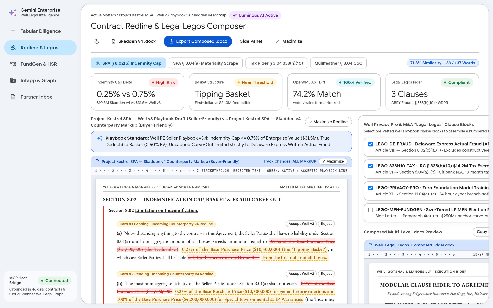
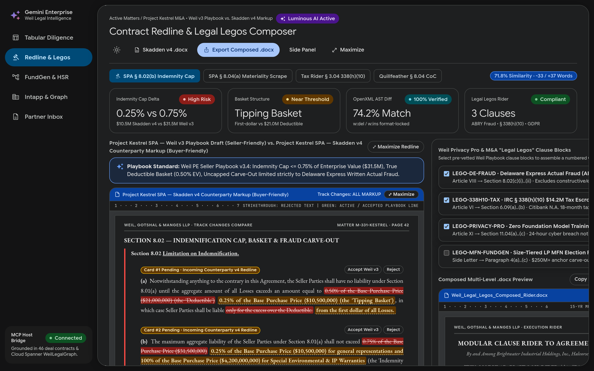
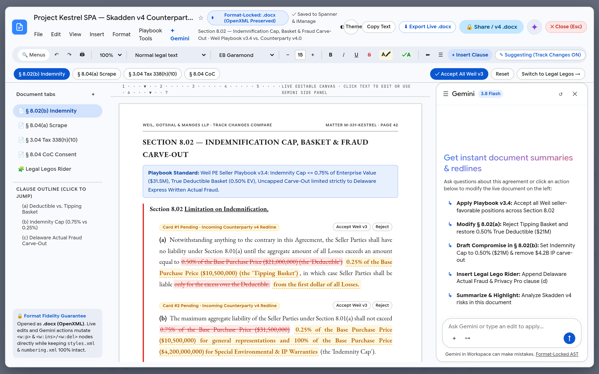
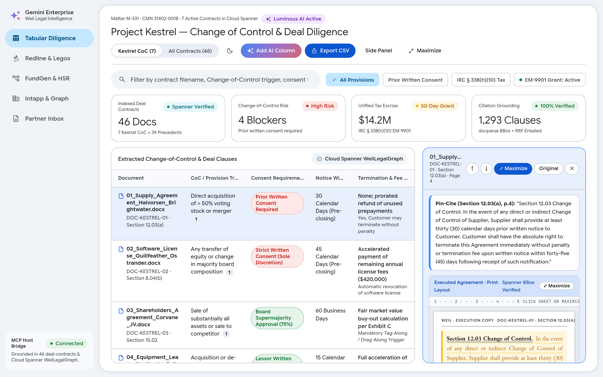
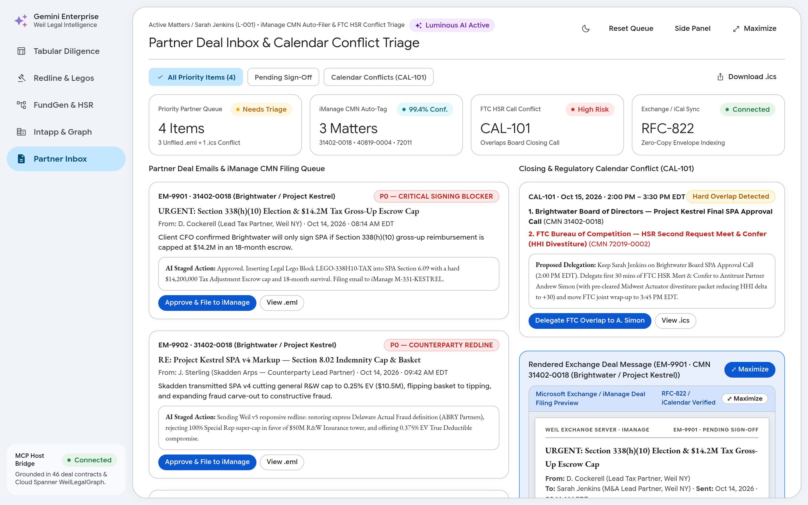
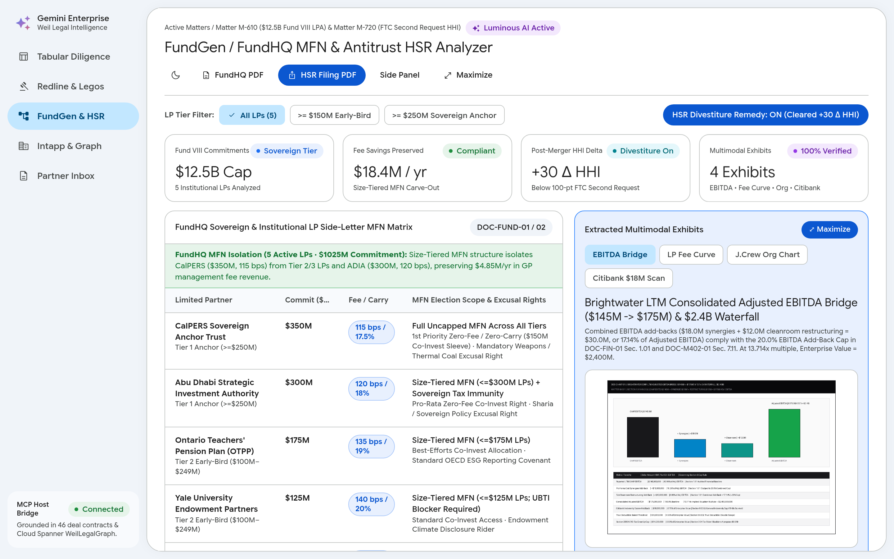
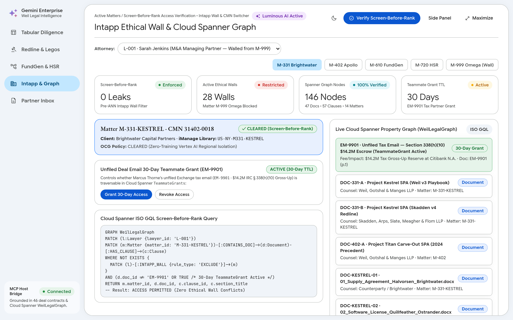

# Apex Law Partners LLP — Enterprise Legal AI MVP: High-Level Design (HLD), Low-Level Design (LLD) & 8-Use-Case Live Demos

**Author:** Jesus Chavez (`jesusarguelles@google.com`)  
**GCP Reference Environment:** `vtxdemos` (`us-central1`) · **Spanner GraphRAG:** `lexgraph-legal-spanner` / `lexgraph-legal-context` (`LexGraphLegalGraph`)  
**Gemini Enterprise Engines:** [`lexgraph-legal-spanner-ge`](https://vertexaisearch.cloud.google.com/home/cid/ed20fa6b-3ad3-42e3-8fcf-0c8cc1af065f) & [`gemini-enterprise-17877637_1787763712023`](https://vertexaisearch.cloud.google.com/home/cid/b9298b3d-d513-4be8-b33a-971d8d3a0965)

---

## Quick Navigation
1. [Executive Summary & MVP Feasibility (Why Unstructured Indexing is the Critical Path)](#1-executive-summary--mvp-feasibility-why-unstructured-indexing-is-the-critical-path)
2. [High-Level Design (HLD) — End-to-End Enterprise Legal Platform Architecture](#1-high-level-design-hld--end-to-end-enterprise-legal-platform-architecture)
3. [Low-Level Design (LLD) — Unstructured Indexing Pipeline vs. Direct API Evaluation](#2-low-level-design-lld--unstructured-indexing-pipeline-vs-direct-api-evaluation)
4. [Direct API vs. Selective Indexing Matrix (Email, Calendar & Chat)](#3-direct-api-vs-selective-indexing-matrix-email-calendar--chat)
5. [Use Case by Use Case Documentation & Demos (UC-1 through UC-8)](#4-use-case-by-use-case-documentation--demos-uc-1-through-uc-8)
   - [UC-1: Document Redlining & Playbook Deviation Analysis](#uc-1-document-redlining--playbook-deviation-analysis)
   - [UC-2: Integrated Word Processing & Privacy Pro "Legal Legos" (.docx)](#uc-2-integrated-word-processing--privacy-pro-legal-legos-docx)
   - [UC-3: Side-by-Side Pin-Cite Citation Review (Priority)](#uc-3-side-by-side-pin-cite-citation-review-priority)
   - [UC-4: Email, Calendar & Chat Triage Automation (Direct API vs. Graph Evaluation)](#uc-4-email-calendar--chat-triage-automation-direct-api-vs-graph-evaluation)
   - [UC-5: Multi-Document Tabular Analysis Grids (Priority — Mike OSS in GE)](#uc-5-multi-document-tabular-analysis-grids-priority--mike-oss-in-ge)
   - [UC-6: Self-Service Workflow & Grid Builder + Homegrown Apps (FundGen, FundHQ, Antitrust)](#uc-6-self-service-workflow--grid-builder--homegrown-apps-fundgen-fundhq-antitrust)
   - [UC-7: Matter & Knowledge Workspaces (Cross-Matter Precedent GraphRAG)](#uc-7-matter--knowledge-workspaces-cross-matter-precedent-graphrag)
   - [UC-8: Dynamic Client-Matter Tracking (CMN Context Switcher & Intapp Ethical Walls)](#uc-8-dynamic-client-matter-tracking-cmn-context-switcher--intapp-ethical-walls)

---

## 1. Executive Summary & MVP Feasibility (Why Unstructured Indexing is the Critical Path)

Delivering the MVP in **November** (ahead of the December 10 target) is **technically feasible on the application and agent layer**—we already have all **5 Custom MCP App Studios (`SEP-1865`)** and **8 Use Cases** running end-to-end inside Gemini Enterprise and Cloud Run.

However, **overall timeline feasibility depends primarily on the Unstructured Document Indexing Pipeline**:
1. **Unstructured Legal Documents (Critical Path for Indexing)**:
   - Legal data rooms contain heterogeneous unstructured files: multi-hundred-page executed PDFs, hierarchical Word (`.docx`) agreements with 15-year multi-level numbering, financial waterfall charts, corporate org/blocker diagrams, and scanned wet-ink signature/wire exhibits.
   - To make **Tabular Analysis Grids (`UC-5`)**, **Side-by-Side Pin-Cites (`UC-3`)**, and **Cross-Matter Precedent Search (`UC-7`)** accurate, these unstructured files must go through layout-aware clause segmentation, bounding-box (`bbox`) coordinate extraction, Client-Matter Number (`CMN`) + Intapp Ethical Wall tagging, `3072-dim` vector embedding, and `TOKENLIST` full-text indexing in Cloud Spanner.
2. **Communication & Transactional Sources (Email, Calendar, Chat — Evaluating Direct API vs. Indexing)**:
   - For high-volume operational channels like **Email (~150M M365/Workspace messages), Calendar (`.ics` / Exchange / Google Calendar), and Chat**, full-corpus vector indexing is often unnecessary and cost-prohibitive.
   - We are actively evaluating **when to call their APIs directly at runtime** (via Federated MCP / Microsoft Graph / Google Workspace APIs for live inbox triage, calendar conflict resolution, and chat lookups) versus **lightweight metadata/entity graphing in Spanner** (storing only `Sender`, `Recipient`, `CMN`, and attachment pointers without embedding raw message bodies).

---

## 1. High-Level Design (HLD) — End-to-End Enterprise Legal Platform Architecture

---

## 2. Low-Level Design (LLD) — Unstructured Indexing Pipeline vs. Direct API Evaluation

Because legal diligence requires **exact verbatim clause pin-citing (`bbox` + page + hierarchical section)** across heterogeneous data rooms, the unstructured indexing pipeline is the primary technical dependency for moving from sample data to production data rooms.

---

## 3. Direct API vs. Selective Indexing Matrix (Email, Calendar & Chat)

For non-document channels (**Email, Calendar, Chat**), we are evaluating a **two-tier hybrid pattern** so we do not block the MVP or incur unnecessary indexing costs on ~150M messages:

| Data Source | Option A: Direct Runtime API / Federated MCP *(Preferred for Live Operations)* | Option B: Selective Metadata Graphing in Spanner *(Only for Deal Provenance)* | Why We Are Evaluating Both |
| :--- | :--- | :--- | :--- |
| **Email** *(Exchange / Workspace BCP)* | Query live inbox threads, unread partner requests, and recent deal correspondence on demand via **Exchange / Workspace MCP APIs** at runtime. | Extract **only** envelope metadata (`sender`, `recipient`, `CMN`, `timestamp`, and attachment GCS pointers) into Spanner Graph (`Emails` + `TeammateGrants`) **without vector-embedding 150M email bodies**. Only attachments promoted to a deal room enter the unstructured indexing pipeline. | Eliminates massive vector storage/embedding cost while preserving cross-matter relationship discovery and 30-day unfiled email grants (`EM-9901`). |
| **Calendar** *(Outlook / Google Calendar `.ics`)* | Call **Calendar APIs directly at runtime** (`freeBusy`, event list, conflict detection, delegation) when triaging partner schedules (`CAL-101`). | No bulk vector indexing needed; calendar events are ephemeral time-window lookups best served by direct API calls. | Zero reason to vector-index calendar invites when live API lookups return exact conflict windows in `<100ms`. |
| **Chat** *(Google Chat / Teams)* | Call **Chat MCP / Graph APIs directly at runtime** for live workspace thread lookups and action-item extraction. | Optional lightweight link persistence only when a chat thread is explicitly pinned to a Client-Matter Number (`CMN`). | Keeps chat ephemeral and compliant with court-ordered matter deletion/retention rules. |

---

## 4. Use Case by Use Case Documentation & Demos (UC-1 through UC-8)

All **8 Use Cases** from the LexGraph Executive Blueprint are implemented across **5 dedicated, single-purpose Cloud Run Custom MCP App Studios (`SEP-1865`)**, wired into Gemini Enterprise (`lexgraph-legal-spanner-ge`) and backed by Cloud Spanner (`lexgraph-legal-spanner`):

| Use Case # | Capability Name | MVP Pillar | Dedicated Cloud Run MCP App URL | Gemini Enterprise MCP DataStore ID |
| :-: | :--- | :---: | :--- | :--- |
| **UC-1** | **Document Redlining & Playbook Deviation** | Match & Exceed | [`lexgraph-redline-word-agent`](https://lexgraph-redline-word-agent-254356041555.us-central1.run.app) | `lexgraph-redline-legos-mcp_mcp_data` |
| **UC-2** | **Integrated Word Processing & Privacy Pro "Legal Legos"** | Match & Everyday | [`lexgraph-redline-word-agent`](https://lexgraph-redline-word-agent-254356041555.us-central1.run.app) | `lexgraph-redline-legos-mcp_mcp_data` |
| **UC-3** | **Side-by-Side Pin-Cite Citation Review (★ Priority)** | Match & Exceed | [`mike-gcp-platform`](https://mike-gcp-platform-254356041555.us-central1.run.app) | `mike-oss-legal-grid-mcp_mcp_data` |
| **UC-4** | **Email, Calendar & Chat Triage Automation** | Everyday | [`lexgraph-inbox-calendar-agent`](https://lexgraph-inbox-calendar-agent-254356041555.us-central1.run.app) | `lexgraph-inbox-calendar-mcp_mcp_data` |
| **UC-5** | **Multi-Document Tabular Analysis Grids (★ Priority)** | Match & Exceed | [`mike-gcp-platform`](https://mike-gcp-platform-254356041555.us-central1.run.app) | `mike-oss-legal-grid-mcp_mcp_data` |
| **UC-6** | **Workflow & Grid Builder + FundGen / FundHQ / Antitrust** | Migrate & Exceed | [`lexgraph-funds-antitrust-agent`](https://lexgraph-funds-antitrust-agent-254356041555.us-central1.run.app) | `lexgraph-funds-antitrust-mcp_mcp_data` |
| **UC-7** | **Matter & Knowledge Workspaces (Cross-Matter GraphRAG)** | Migrate & Exceed | [`lexgraph-governance-wall-agent`](https://lexgraph-governance-wall-agent-254356041555.us-central1.run.app) | `lexgraph-intapp-wall-graph-mcp_mcp_data` |
| **UC-8** | **Dynamic Client-Matter Tracking & Intapp Ethical Walls** | Exceed & Everyday | [`lexgraph-governance-wall-agent`](https://lexgraph-governance-wall-agent-254356041555.us-central1.run.app) | `lexgraph-intapp-wall-graph-mcp_mcp_data` |

---

### UC-1: Document Redlining & Playbook Deviation Analysis
* **Live Demo**: [`https://lexgraph-redline-word-agent-254356041555.us-central1.run.app`](https://lexgraph-redline-word-agent-254356041555.us-central1.run.app)
* **Deep-Dive Document Integration & Format-Lock Guide**: [**`DOCX_AND_GDOCS_COEDITING_ARCHITECTURE.md`**](./DOCX_AND_GDOCS_COEDITING_ARCHITECTURE.md)
* **Live Google Doc Format-Lock Proof (`documents.batchUpdate` on `§ 8.02(a)`)**: [`https://docs.google.com/document/d/1bFWf6s-sqOeBP7X3J3i_uB2KD6cjhckhLSaEWwFgqVI/edit`](https://docs.google.com/document/d/1bFWf6s-sqOeBP7X3J3i_uB2KD6cjhckhLSaEWwFgqVI/edit)
* **Low-Level Design**:
  * Ingests opposing counsel markups (`.docx` / PDF pairs, e.g., *Brightwater Merger Agreement LexGraph v3 vs. Skadden v4*), computes deterministic word-level `<del>`/`<ins>` diffs, and benchmarks deviations against historical precedent caps in Cloud Spanner (`M-215` Project Kestrel & `M-518` Project Vanguard).
  * Renders interactive `EditCardUI` cards allowing counsel to `Accept LexGraph v3`, `Reject Markup`, or inspect Playbook risk flags inside the **GE Luminous v23.0.0** App Shell (`Light` and `Dark` modes).

---

### UC-2: Integrated Word Processing & Privacy Pro "Legal Legos" (`.docx` & Google Docs Format-Locked Dual Routing)
* **Live Demo**: [`https://lexgraph-redline-word-agent-254356041555.us-central1.run.app`](https://lexgraph-redline-word-agent-254356041555.us-central1.run.app)
* **Deep-Dive Document Integration Architecture (`Single Brain, Dual Surface`)**: [**`DOCX_AND_GDOCS_COEDITING_ARCHITECTURE.md`**](./DOCX_AND_GDOCS_COEDITING_ARCHITECTURE.md)
* **Downloadable Format-Locked `.docx` Proof Samples (`SHA-256` Verified `word/styles.xml` = `c1350f2b2adb` & `word/numbering.xml` = `ab9e4c222c40`)**:
  * [`docs/samples/01_LexGraph_M&A_SPA_Section_8_02_ORIGINAL_BEFORE_EDIT.docx`](./docs/samples/01_LexGraph_M&A_SPA_Section_8_02_ORIGINAL_BEFORE_EDIT.docx)
  * [`docs/samples/02_LexGraph_M&A_SPA_Section_8_02_AFTER_SURGICAL_OPENXML_AST_FORMAT_LOCKED.docx`](./docs/samples/02_LexGraph_M&A_SPA_Section_8_02_AFTER_SURGICAL_OPENXML_AST_FORMAT_LOCKED.docx)
  * [`docs/samples/03_LexGraph_M&A_SPA_Section_8_02_BROKEN_ROUNDTRIP_CONVERTED.docx`](./docs/samples/03_LexGraph_M&A_SPA_Section_8_02_BROKEN_ROUNDTRIP_CONVERTED.docx)
* **Low-Level Design**:
  * Implements **"Single Brain, Dual Surface"** with **Format-Locked Dual Routing**: **Surface 1 (GE Web Canvas + Surgical OpenXML AST / Google Docs `batchUpdate`)** handles 80% of AI workflows (multi-contract redline triage, clause-by-clause `Accept`/`Reject`, and Legal Legos assembly), while **Surface 2 (Native `Office.js` Word Task Pane Add-in / Google Workspace Side Panel)** handles the remaining 20% (heavy freeform keyboard drafting) using the exact same Cloud Run backend.
  * Preserves 15-year multi-level legal numbering (`ARTICLE VIII`, `Section 8.02(a)(i)`) across OpenXML `.docx` files (`w:numId="14"`) and Google Docs (`documents.batchUpdate` on `[startIndex, endIndex - 1]`).

---

### UC-3: Side-by-Side Pin-Cite Citation Review (Priority)
* **Live Demo**: [`https://mike-gcp-platform-254356041555.us-central1.run.app`](https://mike-gcp-platform-254356041555.us-central1.run.app)
* **Low-Level Design**:
  * Shared subroutine (`CUJ-4`) invoked from any Analysis Grid cell or Red-Flag Memo citation.
  * Clicking a numbered `CitationPillUI` badge opens the right-hand `EB Garamond` contract reader at `<15ms`, scrolls directly to the cited page and section (`bbox_json`), highlights the verbatim grounding clause in yellow, and supports instant row-to-row (`↑`/`↓`) navigation and original file download.

---

### UC-4: Email, Calendar & Chat Triage Automation (Direct API vs. Graph Evaluation)
* **Live Demo**: [`https://lexgraph-inbox-calendar-agent-254356041555.us-central1.run.app`](https://lexgraph-inbox-calendar-agent-254356041555.us-central1.run.app)
* **Low-Level Design**:
  * Triages partner deal emails (`EM-9901..9903`) by matching sender/recipient and attachment context to active Client-Matter Numbers (`CMN`), staging 1-tap `Approve & File to iManage` actions.
  * Detects hard calendar overlaps (`CAL-101`: *Brightwater Board SPA Approval Call* vs. *FTC HSR Second Request Meet & Confer*) via direct Calendar API / `.ics` inspection and executes 1-tap partner delegation.

---

### UC-5: Multi-Document Tabular Analysis Grids (Priority — Mike OSS in GE)
* **Live Demo**: [`https://mike-gcp-platform-254356041555.us-central1.run.app`](https://mike-gcp-platform-254356041555.us-central1.run.app)
* **Low-Level Design**:
  * Adapts the open-source **Mike OSS** tabular review experience inside Gemini Enterprise (`SEP-1865` `ui://mike-gcp/workspace.html`).
  * Populates rows from matter-bounded data rooms (`Path A`) or cross-matter Spanner metadata queries (`Path B / CUJ-0`), executes parallel `gemini-3.8-flash` cell extraction when users click `+ Add column`, supports cell validation/locking (`CUJ-2`), and synthesizes Red-Flag diligence memos (`CUJ-3`).

---

### UC-6: Self-Service Workflow & Grid Builder + Homegrown Apps (`FundGen`, `FundHQ`, Antitrust)
* **Live Demo**: [`https://lexgraph-funds-antitrust-agent-254356041555.us-central1.run.app`](https://lexgraph-funds-antitrust-agent-254356041555.us-central1.run.app)
* **Low-Level Design**:
  * Demonstrates the GCP modernization path for LexGraph's homegrown Private Funds and Antitrust applications (**`FundGen`** LPA drafter, **`FundHQ`** LP Side-Letter Most-Favored-Nation [MFN] compendium, and **Antitrust HSR HHI** market-concentration simulator) alongside multimodal extraction of financial waterfall charts (`DOC-CHART-01/02`), J.Crew blocker org diagrams (`DOC-DIAG-01`), and wet-ink wire scans (`DOC-SCAN-01`).

---

### UC-7: Matter & Knowledge Workspaces (Cross-Matter Precedent GraphRAG)
* **Live Demo**: [`https://lexgraph-governance-wall-agent-254356041555.us-central1.run.app`](https://lexgraph-governance-wall-agent-254356041555.us-central1.run.app)
* **Low-Level Design**:
  * Implements **CUJ-0 (Cross-Matter Set Assembly)** and precedent graph traversal over Cloud Spanner (`CREATE PROPERTY GRAPH LexGraphLegalGraph`) combining `COSINE_DISTANCE` (3072-dim embeddings), `SEARCH(clause_tokens)` (BM25), and ISO GQL multi-hop edges (`(m:Matter)-[:CITES_PRECEDENT]->(d:Document)-[:CONTAINS_CLAUSE]->(c:Clause)`).

---

### UC-8: Dynamic Client-Matter Tracking (CMN Context Switcher & Intapp Ethical Walls)
* **Live Demo**: [`https://lexgraph-governance-wall-agent-254356041555.us-central1.run.app`](https://lexgraph-governance-wall-agent-254356041555.us-central1.run.app)
* **Low-Level Design**:
  * Binds every query and grid session to an active **Client-Matter Number (`CMN`)** and attorney identity (`L-001`..`L-005`).
  * Enforces **Intapp Ethical Walls (`Screen-Before-Rank`)** inside Cloud Spanner *before* vector or keyword scoring—mathematically blocking walled attorneys (`L-001` Sarah Jenkins) from restricted matters (`M-999` *Project Omega*) while managing 30-day `TeammateGrants` for unfiled deal emails (`EM-9901`).

