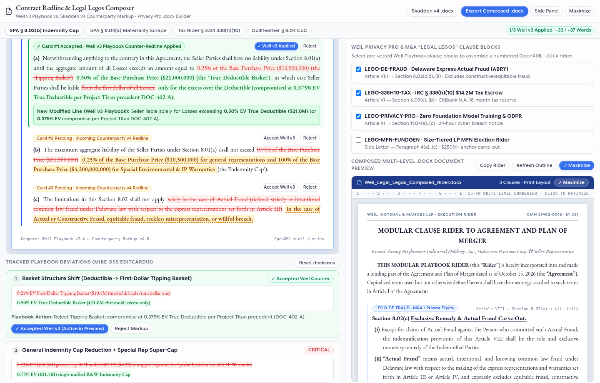
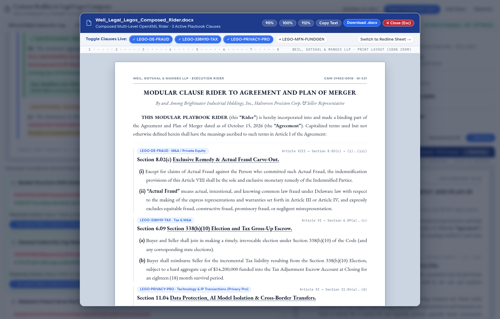

# Weil, Gotshal & Manges LLP — Presenter Guide & Live Demo Playbook (All 5 Studios)

> **Purpose of This Guide**: A plain-English, zero-jargon cheat sheet explaining **who Weil and Skadden are**, **why each studio exists**, **where Gemini 3.8 Flash + Cloud Spanner GraphRAG is used**, and **exactly what to click and say** during a live presentation across all **5 Cloud Run Studios**.

---

## 1. Master Directory of All 5 Live Cloud Run Demos

Every studio below is deployed live on Google Cloud Run (`vtxdemos`, `us-central1`) and also registered as a Custom MCP App (`SEP-1865`) inside **Gemini Enterprise (`weil-legal-spanner-ge`)**:

| Studio # | Studio Name | Weil MVP Use Cases Covered | Direct Live Cloud Run Demo Link | What to Click to Test It Live |
| :---: | :--- | :--- | :--- | :--- |
| **Studio 1** | **Mike OSS Tabular Diligence Grid & Pin-Cite Reader** | • **UC-1**: Multi-Doc Tabular Extraction Grid<br>• **UC-4**: Side-by-Side Citation Verification | [**Open Studio 1 (Tabular Grid)**](https://mike-gcp-platform-254356041555.us-central1.run.app) | 1. Click any row or numbered citation badge (`1`, `2`, `3`) → opens the right-side Contract Pin-Cite Reader with yellow highlighting.<br>2. Click **`⤢ Maximize`** on the reader to open the centered full-page `.docx` overlay.<br>3. Click **`+ Add Column`** and type any question (e.g., *"What is the governing law?"*) → runs **live `gemini-3.8-flash`** across every contract.<br>4. Toggle **`All Corpus (30)`** vs. **`Project Kestrel (11)`** and **`EM-9901 Grant`**. |
| **Studio 2** | **Contract Redline & Word "Legal Legos" Composer** | • **UC-2**: Document Redlining & Playbook Deviations<br>• **UC-3**: Word "Legal Legos" & Privacy Pro Builder | [**Open Studio 2 (Redline & Legal Legos)**](https://weil-redline-word-agent-254356041555.us-central1.run.app) | 1. **Left Side (Redline)**: Click **`Accept Weil v3`** or **`Reject`** on Cards #1, #2, #3 (or inline on subclauses `(a)`, `(b)`, `(c)`) → crosses out Skadden's v4 text in red and inserts Weil's v3 counter-redline in green.<br>2. Switch top clause tabs (`§ 8.04(a) Scrape`, `Tax § 3.04`, `Quillfeather § 8.04`).<br>3. **Right Side (Legal Legos)**: Check/uncheck **`LEGO-MFN-FUNDGEN`** → live-composes the numbered `.docx` Rider.<br>4. Click **`⤢ Maximize`** on either sheet to open the centered print-layout modal. |
| **Studio 3** | **FundGen / FundHQ MFN & Antitrust HSR Second Request Lab** | • **UC-5**: Private Funds LPA (`FundGen`) & LP Side-Letter MFN Matrix (`FundHQ`)<br>• **UC-6**: Antitrust HSR HHI & Multimodal Chart Extraction | [**Open Studio 3 (Funds & Antitrust)**](https://weil-funds-antitrust-agent-254356041555.us-central1.run.app) | 1. Click the LP Commitment Tier filter pills (**`$250M+ Anchor`**, **`$100M+ Tier`**, **`All Tiers`**) → filters the MFN eligibility matrix and recalculates fee savings.<br>2. Click **`HSR Divestiture Remedy: ON / OFF`** → dynamically updates the HHI Market Concentration bars (`27.6%` Net of 6% Divestiture vs. `33.6%` Unremedied).<br>3. Switch multimodal exhibit tabs (`EBITDA Bridge`, `J.Crew IP Blocker`, `Wet-Ink Escrow`, `Fee Curve`) and click **`⤢ Maximize`**. |
| **Studio 4** | **Intapp Ethical Wall & Cloud Spanner Property Graph** | • **UC-7**: Intapp Ethical Wall (`Screen-Before-Rank`) & Dynamic CMN Switcher | [**Open Studio 4 (Ethical Wall & Graph)**](https://weil-governance-wall-agent-254356041555.us-central1.run.app) | 1. Switch **Active Lawyer** (`Sarah Jenkins L-001` vs. `David Thorne L-002`) and **Target Matter** (`M-999 Project Omega` vs. `M-331 Project Kestrel`) → shows `DENY (HTTP 403)` when an Intapp Wall blocks access.<br>2. Click **`Revoke Access`** / **`Grant 30-Day Access`** on `EM-9901` → dynamically updates the Cloud Spanner ISO GQL query and Property Graph nodes. |
| **Studio 5** | **Partner Deal Inbox, Calendar Conflict & iPad Triage** | • **UC-8**: Partner Deal Email Triage (`.eml`), Calendar Conflict (`.ics`), and 1-Tap iPad Sign-Off | [**Open Studio 5 (Inbox & Calendar)**](https://weil-inbox-calendar-agent-254356041555.us-central1.run.app) | 1. Click the **`Calendar Conflicts (CAL-101)`** filter tab → renders the `.ics` Exchange Calendar Conflict (`Board Call vs. FTC HSR Hearing`).<br>2. Click any email row (`EM-9901`, `EM-9902`, `EM-9903`) → renders the formatted Outlook `.eml` message sheet.<br>3. Click **`Approve & File to iManage`** or **`Delegate FTC Overlap to A. Simon`** → stamps the `.eml` document preview with a green verification banner.<br>4. Click **`⤢ Maximize`** to view the `.eml` / `.ics` in the centered modal. |

---

## 2. Deep Dive: How to Understand & Present Studio 2 (`Contract Redline & Legal Legos Composer`)



### 2.1 Plain-English Background (Zero Legal Jargon)

#### Who is Weil vs. Who is Skadden?
- **Weil (`Weil, Gotshal & Manges`)** is **our customer**—one of the largest corporate law firms in the world. In this demo scenario, Weil represents the **Seller** of a `$4.2 Billion` industrial company (**"Project Kestrel"**).
- **Skadden (`Skadden, Arps`)** is a **competing Wall Street law firm** representing the **Buyer** on the other side of the transaction.
- **How a corporate negotiation works**:
  1. **Weil (`Draft v3`)** writes the initial sale contract (*Stock Purchase Agreement*, or `SPA`) with Seller-friendly protections (strictly limiting how much the Seller can be sued for after the deal closes).
  2. **Skadden (`Draft v4`)** edits that Word document and sends it back with aggressive Buyer-friendly changes (trying to make the Seller pay from dollar #1 or removing the liability ceiling altogether).

---

### 2.2 Why Are There Two Different Document Views on This Screen?
In Weil's requirements (**Slide 3 of the MVP Deck** and Daulton Cockerell's workstream notes), lawyers use Microsoft Word for **two separate workflows** during a deal:

```text
┌──────────────────────────────────────────────────────────────────────┐
│ 1. LEFT SIDE: "FIGHTING THE OTHER LAW FIRM'S EDITS" (UC-2 Redlining) │
│                                                                      │
│ • Requirement: Replace/augment Syntheia Compare MCP & Litera Compare.│
│ • What it shows: The existing contract (`Project Kestrel SPA`) where │
│   the Buyer's lawyers (Skadden v4) made sneaky edits.                │
│ • What clicking [Accept Weil v3] does:                               │
│   Crosses out Skadden's aggressive edit in red (<del>) and inserts   │
│   Weil's standard Playbook counter-proposal in green (<ins>).        │
└──────────────────────────────────┬───────────────────────────────────┘
                                   │
                                   ▼
┌──────────────────────────────────────────────────────────────────────┐
│ 2. RIGHT SIDE: "SNAPPING TOGETHER PRE-APPROVED CLAUSES" (UC-3 Legos) │
│                                                                      │
│ • Requirement: Weil Privacy Pro ("Legal Legos") & FormSpec .docx     │
│   builder preserving 15-year multi-level Word numbering.             │
│ • Why Weil calls it "Legal Legos":                                   │
│   Instead of typing specialty rules from scratch (or copy-pasting    │
│   from old Word files and breaking paragraph numbering), lawyers     │
│   check boxes to snap pre-approved building-block paragraphs         │
│   together like Lego bricks into a clean Addendum (`Rider.docx`).    │
└──────────────────────────────────────────────────────────────────────┘
```

- **Are "Project Kestrel" and "Skadden v4" from Weil's requirement?**
  - **The capabilities and tool names** (*Document Redlining*, *Playbook Deviation Cards*, *Weil Privacy Pro "Legal Legos"*, *15-year `.docx` multi-level numbering*) come **100% from Weil's explicit MVP requirements**.
  - **The specific contract text** (*Project Kestrel*, *Brightwater*, *Skadden v4 vs. Weil v3*) is **synthetic mock M&A data** so we can demonstrate those exact workflows safely without exposing confidential client files.

---

### 2.3 Where Is AI (`Gemini 3.8 Flash` + `Cloud Spanner GraphRAG`) Used Here?

A regular diff tool (like Microsoft Word Track Changes or Litera Compare) only performs a **dumb character diff**—it tells you that `"0.50% Deductible"` was changed to `"0.25% Tipping Basket"`, but it has **no idea** whether that change is dangerous, whether it violates firm policy, or how to fix it.

Here are the **4 places where AI + Cloud Spanner GraphRAG powers this screen**:

1. **Semantic Playbook Risk Scoring (`Gemini 3.8 Flash`)**:
   - Reads the raw redline diff against the **Weil PE Seller Playbook v3.4** (shown in the blue banner at the top) and flags which counterparty edits are **`CRITICAL`** financial traps (**Cards #1, #2, #3**).
2. **Historical Deal Precedent Retrieval (`Cloud Spanner GraphRAG` + `3,072-dim gemini-embedding-001`)**:
   - Look at the green text in Subclause `(a)` and Card #1's Playbook Action:
     > *"Reject Tipping Basket; compromise at 0.375% EV True Deductible per Project Titan precedent DOC-402-A."*
   - The AI queries **Cloud Spanner GraphRAG** (`MATCH (m:Matter)-[:CITES_PRECEDENT]->(d:Document)`) across past closed Weil deals to answer: *"Last time Weil negotiated against Skadden on a similar deal (`Project Titan`), what compromise number did both sides accept?"*
3. **Automated Counter-Redline Drafting (`Gemini 3.8 Flash`)**:
   - Pre-writes the exact green replacement legal clause (`<ins class="redline-ins">...</ins>`) so the lawyer simply clicks **`Accept Weil v3`** instead of drafting from scratch.
4. **"Legal Legos" Clause Selection & Multi-Level Numbering Alignment**:
   - Recommends which standard Weil rider blocks (`LEGO-DE-FRAUD`, `LEGO-338H10-TAX`, `LEGO-PRIVACY-PRO`, `LEGO-MFN-FUNDGEN`) are needed for this deal and formats them into a clean `.docx` print layout with preserved hierarchical numbering (`Article VIII → Section 8.02(c)(i)..(ii)`).

---

### 2.4 Plain-English Dictionary of the 4 Legal Terms on Screen

| Legal Term on Screen | Plain-English Meaning (How to Explain It in 10 Seconds) |
| :--- | :--- |
| **1. `True Deductible` vs. `Tipping Basket`** *(Card #1 / Subclause a)* | • **True Deductible (`$21M`)**: Works just like car insurance—if the deductible is `$21M` and losses are `$25M`, the Seller only pays the **`$4M` excess**.<br>• **Tipping Basket (`$10.5M`)**: Once losses cross `$10.5M`, the basket "tips over" and the Seller has to pay the **entire amount from dollar #1**. Sellers always reject Tipping Baskets. |
| **2. `Indemnity Cap`** *(Card #2 / Subclause b)* | The maximum dollar ceiling the Seller can ever be sued for after the sale closes. Weil capped it at **`$31.5M` (`0.75%` of the `$4.2B` price)**; Skadden tried to sneak in **100% (`$4.2 Billion`) uncapped liability** for IP and Environmental claims. |
| **3. `Actual Fraud (ABRY Partners)`** *(Card #3 / Subclause c & Lego #1)* | A famous Delaware court rule (`ABRY Partners`) stating that a Buyer can only bypass the Liability Cap if the Seller **intentionally lied in writing** inside the contract—not for accidental mistakes or "reckless/constructive" claims. |
| **4. `IRC § 338(h)(10) Tax Escrow`** *(Tab 3 & Lego #2)* | An IRS tax election that gives the Buyer a massive tax write-off, in exchange for the Buyer funding **`$14.2M` into a Citibank escrow account** to reimburse the Seller for any extra tax bill. |

---

### 2.5 Word-for-Word 90-Second Demo Script for Studio 2

1. **Point to the Left Document Preview (`Project Kestrel SPA — Skadden v4`)**:
   - *"On the left, we have Capability #1 from Weil's MVP deck: Document Redlining and Playbook Deviation Analysis. In this `$4.2B` deal, the Buyer's law firm (Skadden) sent back Draft v4 with three aggressive edits in Section 8.02."*
2. **Click `Accept Weil v3` on Card #1, Card #2, and Card #3**:
   - *"Word or Litera only tells you which characters changed. Gemini 3.8 Flash compares Skadden's markup against the Weil PE Seller Playbook, searches Cloud Spanner GraphRAG to find what compromise Weil used in past deals (`Project Titan DOC-402-A`), and pre-writes the counter-redline. As I click **Accept Weil v3** on Cards #1, #2, and #3, watch subclauses `(a)`, `(b)`, and `(c)` in the Word preview immediately strike through Skadden's language in red and insert Weil's counter-redline in green."*
3. **Point to the Right Side (`"Legal Legos" Clause Blocks`) and check `LEGO-MFN-FUNDGEN`**:
   - *"On the right, we have Capability #2: Weil's 'Legal Legos' and Privacy Pro composer. Instead of associates copy-pasting from old Word documents—which breaks Microsoft Word's 15-year multi-level numbering—they check pre-vetted building blocks like `LEGO-DE-FRAUD`, `LEGO-338H10-TAX`, and `LEGO-PRIVACY-PRO`. When I check `LEGO-MFN-FUNDGEN`, it snaps Paragraph 4(a)–(c) directly into the composed `.docx` Rider."*
4. **Click `⤢ Maximize` on either document header**:
   - *"And clicking **Maximize** opens the full-document 8.5×11 Print Layout overlay right in the center of the screen with live zoom (`90%`, `100%`, `112%`), live clause toggles, and 1-click `.docx` download."*


