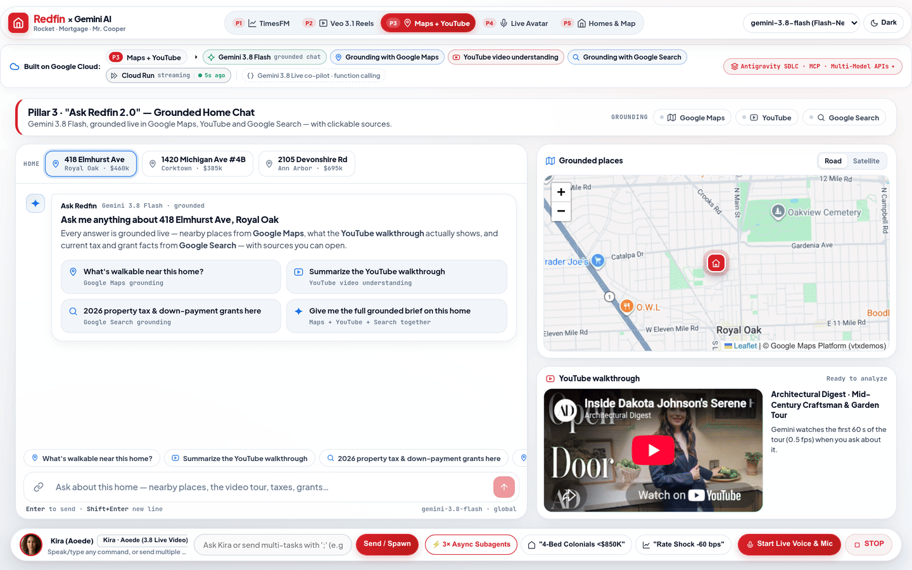
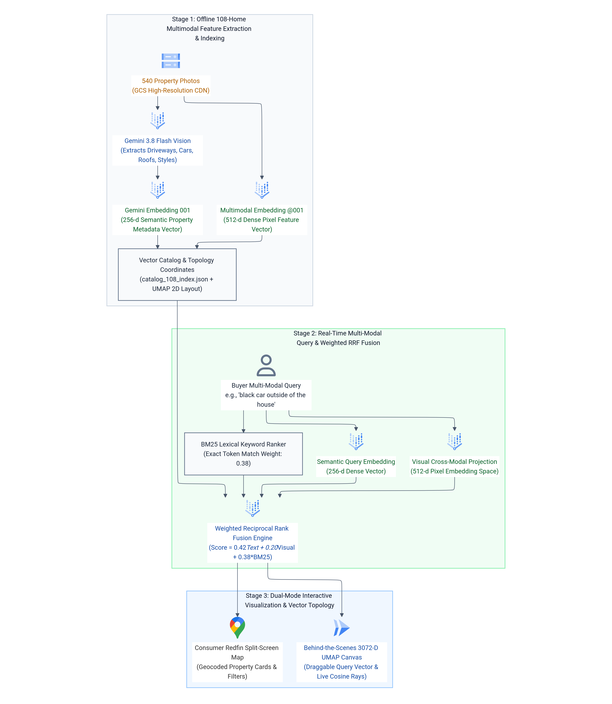
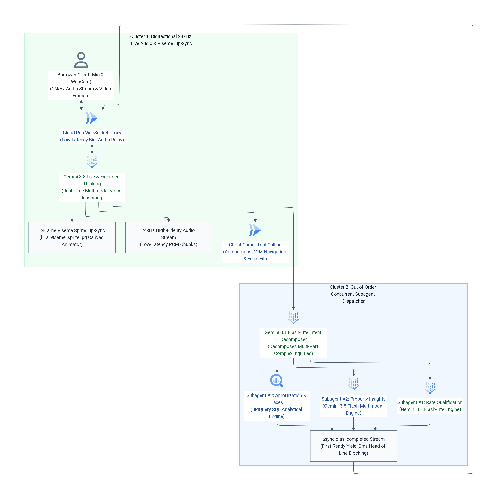

# 🚀 Rocket Companies × Google Gemini · Next-Generation 5-Pillar AI Studio (`v35`)

> **Live Production Demo (`demo-stable`):** [**`https://demo-stable---rocket-polymorphic-search-oyntfgdwsq-uc.a.run.app/`**](https://demo-stable---rocket-polymorphic-search-oyntfgdwsq-uc.a.run.app/)  
> **Built for Rocket Companies (NYSE: RKT · Redfin · Rocket Mortgage · Mr. Cooper $2.1T Servicing · Rocket Money)**  
> Showcasing the **5 Google Cloud & Vertex AI Next-Gen Pillars** that text-only models (such as Anthropic Claude) cannot replicate natively—complete with **live animated GIFs & MP4 videos**, **`3x Retina` Vector SVG/PNG + `3x HiDPI` Mermaid ELK Architecture Diagrams**, **Block-by-Block Component Walkthroughs**, **1-Shot LLM Replication Skills (`SKILL.md`)**, and **Customer Environment Variable Templates (`.env.example`)**.

---

## 🧭 Pillar Directory & Quick Navigation

Each pillar resides in its own self-contained subfolder with its own **`README.md`**, **`SKILL.md`**, **`.env.example`**, **`engine.py`**, **animated `.gif` & `.mp4` demo**, and **high-definition architecture diagrams**:

| Pillar Subfolder | Core Google Cloud & Vertex AI Stack | Live Demo Deep-Link | Replicate via LLM Skill |
| :--- | :--- | :---: | :---: |
| **[`pillar-1-bqml-timesfm/`](pillar-1-bqml-timesfm/)** | **BigQuery ML `AI.FORECAST` (`TimesFM 2.0`)** · Zero-shot SQL forecasting over 9.5M Mr. Cooper + Rocket servicing loans (`<900ms`, P10–P90 CI, `-150` to `+100 bps` rate-shock scaler) | [Open Pillar 1](https://demo-stable---rocket-polymorphic-search-oyntfgdwsq-uc.a.run.app/?pillar=1) | [`pillar-1-bqml-timesfm/SKILL.md`](pillar-1-bqml-timesfm/SKILL.md) |
| **[`pillar-2-veo-reels-studio/`](pillar-2-veo-reels-studio/)** | **`veo-3.1-generate-001` + `gemini-3.1-flash-image` + `gemini-3.8-flash`** · Vertical `9:16` Social Reels Studio with burned-in Rocket Mortgage PITI stickers, 24kHz audio & 11-Reel Edge Vault | [Open Pillar 2](https://demo-stable---rocket-polymorphic-search-oyntfgdwsq-uc.a.run.app/?pillar=2) | [`pillar-2-veo-reels-studio/SKILL.md`](pillar-2-veo-reels-studio/SKILL.md) |
| **[`pillar-3-trimodal-grounding/`](pillar-3-trimodal-grounding/)** | **"Ask Redfin 2.0" Streaming Tri-Modal Grounded Chat** · `gemini-3.8-flash` combining `GoogleMaps` + `YouTube` Video URI + `GoogleSearch` + Places API (New) Leaflet pins & 8s tail-latency guard | [Open Pillar 3](https://demo-stable---rocket-polymorphic-search-oyntfgdwsq-uc.a.run.app/?pillar=3) | [`pillar-3-trimodal-grounding/SKILL.md`](pillar-3-trimodal-grounding/SKILL.md) |
| **[`pillar-4-live-api-avatar/`](pillar-4-live-api-avatar/)** | **`gemini-3.8-live` Video Avatar Stage & Async Subagents** · Native 16kHz PCM mic + Server VAD + 40ms Barge-In + Continuous-fMP4 704×1280 24fps Avatars (`Kira`, `Sam`, `Ben`, `Vera`, `Leo`) + `asyncio.as_completed` Swarm | [Open Pillar 4](https://demo-stable---rocket-polymorphic-search-oyntfgdwsq-uc.a.run.app/?pillar=4) | [`pillar-4-live-api-avatar/SKILL.md`](pillar-4-live-api-avatar/SKILL.md) |
| **[`pillar-5-realestate-marketplace/`](pillar-5-realestate-marketplace/)** | **108-Home Multimodal Vector Marketplace ("Redfin Powered by Rocket")** · `multimodalembedding@001` (512-d) + `gemini-embedding-001` (256-d) + BM25 + 3072-D UMAP 2D Topology + 108 Pre-Rendered 720p Cinematic & Veo 3.1 Tours + Honest 8-Photo Live Gemini Judge | [Open Pillar 5](https://demo-stable---rocket-polymorphic-search-oyntfgdwsq-uc.a.run.app/?pillar=5) | [`pillar-5-realestate-marketplace/SKILL.md`](pillar-5-realestate-marketplace/SKILL.md) |

---

## 🎬 1. Live GIF & Video Examples Across All 5 Pillars

### Pillar 1 · BigQuery ML `AI.FORECAST` (`TimesFM 2.0`)
  
*🎥 [Download High-Res MP4 (`pillar-1-bqml-timesfm/assets/p1_bqml_timesfm_demo.mp4`)](pillar-1-bqml-timesfm/assets/p1_bqml_timesfm_demo.mp4) · 📖 [Full Pillar 1 Documentation](pillar-1-bqml-timesfm/README.md)*

### Pillar 2 · Text-to-9:16 Reels Studio (`Veo 3.1` + `Imagen 4` + `24kHz Audio`)
  
*🎥 [Download High-Res MP4 (`pillar-2-veo-reels-studio/assets/p2_veo_reels_demo.mp4`)](pillar-2-veo-reels-studio/assets/p2_veo_reels_demo.mp4) · 📖 [Full Pillar 2 Documentation](pillar-2-veo-reels-studio/README.md)*

### Pillar 3 · "Ask Redfin 2.0" Streaming Tri-Modal Grounded Chat (`Maps` + `YouTube` + `Search`)
  
*🎥 [Download High-Res MP4 (`pillar-3-trimodal-grounding/assets/p3_trimodal_grounding_demo.mp4`)](pillar-3-trimodal-grounding/assets/p3_trimodal_grounding_demo.mp4) · 📖 [Full Pillar 3 Documentation](pillar-3-trimodal-grounding/README.md)*

### Pillar 4 · `gemini-3.8-live` Video Avatar Stage & Out-of-Order Async Subagents
  
*🎥 [Download High-Res MP4 (`pillar-4-live-api-avatar/assets/p4_live_avatar_demo.mp4`)](pillar-4-live-api-avatar/assets/p4_live_avatar_demo.mp4) · 📖 [Full Pillar 4 Documentation](pillar-4-live-api-avatar/README.md)*

### Pillar 5 · 108-Home Multimodal Vector Marketplace, UMAP Topology, Tours & Honest Judge
  
*🎥 [Download High-Res MP4 (`pillar-5-realestate-marketplace/assets/p5_realestate_marketplace_demo.mp4`)](pillar-5-realestate-marketplace/assets/p5_realestate_marketplace_demo.mp4) · 📖 [Full Pillar 5 Documentation](pillar-5-realestate-marketplace/README.md)*

---

## 🏛️ 2. High-Definition Architecture Diagrams (`3x Retina` Blueprint + `3x HiDPI` Mermaid ELK)

### 2.1 Master Google Cloud Reference Architecture Blueprint (`3x Retina` + Vector `.svg`)
- **Infinite-Resolution Vector SVG:** [`docs/diagrams/00_rocket_gcp_reference_architecture.svg`](docs/diagrams/00_rocket_gcp_reference_architecture.svg)
- **3x Retina PNG (`4800px` wide):** [`docs/diagrams/00_rocket_gcp_reference_architecture.png`](docs/diagrams/00_rocket_gcp_reference_architecture.png)


### 2.2 Master Corporate `mermaid-designer` (`cl/987790103`, `3x HiDPI` ELK + Neo) Diagrams
1. **Master 5-Pillar Architecture (`3x HiDPI`):**
     
   *Mermaid Source: [`docs/diagrams/01_rocket_5pillar_master_architecture.mmd`](docs/diagrams/01_rocket_5pillar_master_architecture.mmd)*
2. **Pillar 5 Multimodal Vector Search Pipeline (`3x HiDPI`):**
     
   *Mermaid Source: [`docs/diagrams/02_pillar5_multimodal_vector_pipeline.mmd`](docs/diagrams/02_pillar5_multimodal_vector_pipeline.mmd)*
3. **Pillar 4 Live Avatar & Out-of-Order Async Subagents (`3x HiDPI`):**
     
   *Mermaid Source: [`docs/diagrams/03_pillar4_live_avatar_async_subagents.mmd`](docs/diagrams/03_pillar4_live_avatar_async_subagents.mmd)*
4. **Per-Pillar Blueprints & Mermaid Diagrams:**
   - **Pillar 1:** [`p1_architecture_blueprint.png`](pillar-1-bqml-timesfm/assets/p1_architecture_blueprint.png) · [`p1_mermaid_flow_padded.png`](pillar-1-bqml-timesfm/assets/p1_mermaid_flow_padded.png)
   - **Pillar 2:** [`p2_architecture_blueprint.png`](pillar-2-veo-reels-studio/assets/p2_architecture_blueprint.png) · [`p2_mermaid_flow_padded.png`](pillar-2-veo-reels-studio/assets/p2_mermaid_flow_padded.png)
   - **Pillar 3:** [`p3_architecture_blueprint.png`](pillar-3-trimodal-grounding/assets/p3_architecture_blueprint.png) · [`p3_mermaid_flow_padded.png`](pillar-3-trimodal-grounding/assets/p3_mermaid_flow_padded.png)
   - **Pillar 4:** [`p4_architecture_blueprint.png`](pillar-4-live-api-avatar/assets/p4_architecture_blueprint.png) · [`p4_mermaid_flow_padded.png`](pillar-4-live-api-avatar/assets/p4_mermaid_flow_padded.png)
   - **Pillar 5:** [`p5_architecture_blueprint.png`](pillar-5-realestate-marketplace/assets/p5_architecture_blueprint.png) · [`p5_mermaid_flow_padded.png`](pillar-5-realestate-marketplace/assets/p5_mermaid_flow_padded.png)

---

## 🧩 3. Block-of-Component Diagram Walkthrough

```text
┌──────────────────────────────────────────────────────────────────────────┐
│ [BLOCK 1] BROWSER STUDIO SHELL & MODULAR IIFE RUNTIME (`static/*.js`)    │
│  • `ui_studio.py`: Single-Page 5-Pillar Shell + 12-Archetype UI Studio   │
│  • `live_session.js`: `window.RocketLive` (16kHz PCM Mic + fMP4 MSE)     │
│  • `p4_stage.js`: 4:5 Portrait Live Video Avatar Stage (Kira/Sam/Ben...) │
│  • `p3_chat.js`: Streaming NDJSON Chat + Leaflet Pins + YouTube Seeker   │
│  • `p5_media.js`: Photo Lightbox + Pre-Rendered 720p & Veo 3.1 Tours     │
│  • `gcp_strip.js`: Dynamic Per-Tab "Built on Google Cloud" Beacons       │
└────────────────────────────────────┬─────────────────────────────────────┘
                                     │ HTTPS REST / NDJSON / WebSocket
                                     ▼
┌──────────────────────────────────────────────────────────────────────────┐
│ [BLOCK 2] FASTAPI HIGH-CONCURRENCY GATEWAY (`app.py` on Cloud Run)       │
│  • HMAC-SHA256 Cookie & `?auth_token=` Security Gate (`ROCKET_SECRET`)   │
│  • Customer Env Loader (`GCP_PROJECT_ID`, `BQ_DATASET_ID`, `GCS_...`)    │
│  • Startup Pre-Warmer (`p4_engine.get_warm_live_client`, `get_catalog`)  │
│  • Out-of-Order Subagent Router (`/api/async-subagents/decompose`)       │
└────────────────────────────────────┬─────────────────────────────────────┘
                                     │
         ┌───────────────┬───────────┴───┬───────────────┬───────────────┐
         ▼               ▼               ▼               ▼               ▼
┌─────────────┐ ┌─────────────┐ ┌─────────────┐ ┌─────────────┐ ┌─────────────┐
│  [BLOCK 3]  │ │  [BLOCK 4]  │ │  [BLOCK 5]  │ │  [BLOCK 6]  │ │  [BLOCK 7]  │
│  PILLAR 1   │ │  PILLAR 2   │ │  PILLAR 3   │ │  [PILLAR 4] │ │  PILLAR 5   │
│ BQML SQL    │ │ Veo 3.1 9:16│ │ Ask Redfin  │ │ Gemini 3.8  │ │ 108-Home RE │
│ AI.FORECAST │ │ Reels Studio│ │ 2.0 Grounded│ │ Live Video  │ │ Multimodal  │
│ (TimesFM 2) │ │ + Imagen 4  │ │ NDJSON Chat │ │ Avatars+VAD │ │ Vector+Judge│
└─────────────┘ └─────────────┘ └─────────────┘ └─────────────┘ └─────────────┘
```

| Block | Component & Primary Files | Google Cloud Services & Models | What It Does & Why It Matters |
| :---: | :--- | :--- | :--- |
| **Block 1** | **Frontend Runtime Modules** (`ui_studio.py`, `static/live_session.js`, `live_bridge.js`, `p4_stage.js`, `p3_chat.js`, `p5_media.js`, `gcp_strip.js`) | Cloud Run Static Assets + WebAudio API + MediaSource Extensions (MSE) | Wraps `window.switchPillar` cleanly before `DOMContentLoaded`, streams 16kHz PCM mic audio to `/ws/live-avatar`, renders 704×1280 24fps fMP4 avatar video with zero flicker, and lights up active GCP services in `#gcp-arch-strip`. |
| **Block 2** | **Unified FastAPI Gateway** (`app.py`) | Cloud Run (`us-central1`, `--timeout 3600`) | Authenticates sessions via HMAC-SHA256 tokens, reads customer environment variables (`GCP_PROJECT_ID`, `BQ_DATASET_ID`, `GCS_MEDIA_BUCKET`), and dispatches REST, NDJSON streaming, and bidirectional WebSocket calls. |
| **Block 3** | **Pillar 1 Engine** (`pillar-1-bqml-timesfm/engine.py`) | BigQuery ML `AI.FORECAST` (`TimesFM 2.0`) | Runs zero-shot foundation time-series forecasting directly in SQL over `portfolio_metrics` in `~900ms`, applying cohort rate-shock elasticity (`-150` to `+100 bps`) with P10–P90 confidence intervals. |
| **Block 4** | **Pillar 2 Engine** (`pillar-2-veo-reels-studio/engine.py`) | `veo-3.1-generate-001` + `gemini-3.1-flash-image` + `gemini-3.8-flash` | Generates vertical `9:16` property reels with parallel script + keyframe generation, 24kHz audio narration, burned-in Rocket Mortgage PITI stickers, and 11 instant pre-rendered reels (`static/reels/`). |
| **Block 5** | **Pillar 3 Engine** (`pillar-3-trimodal-grounding/engine.py`) | `gemini-3.8-flash` (`global`) + `GoogleMaps` + `YouTube` + `GoogleSearch` + Places API (New) | Streams grounded NDJSON answers (`POST /api/pillar3/chat`) using a zero-latency keyword router, an 8s tail-latency dual-flight race guard, and Places API (New) lat/lng pin resolution on Leaflet. |
| **Block 6** | **Pillar 4 Engine** (`pillar-4-live-api-avatar/engine.py`) | `gemini-3.8-live` (`us-central1`) + `AvatarConfig` + `gemini-3.1-flash-lite` | Streams native bidirectional voice & 704×1280 24fps official video avatars (`Kira`, `Sam`, `Ben`, `Vera`, `Leo`) by caching the `ftyp+moov` fMP4 init segment across turns and barge-in interrupts (`40ms`), paired with `asyncio.as_completed` subagents. |
| **Block 7** | **Pillar 5 Engine** (`pillar-5-realestate-marketplace/engine.py`, `render_tours.py`, `veo_tours.py`) | `gemini-3.8-flash` Vision + `multimodalembedding@001` (512-d) + `gemini-embedding-001` (256-d) + `veo-3.1-fast-generate-001` | Powers hybrid pixel + semantic + BM25 search across 108 homes, interactive 3072-D UMAP 2D topology (`#btn-toggle-behind-scenes`), 108 pre-rendered 720p cinematic tours, 10 Veo 3.1 walkthroughs, photo lightbox, and an honest 8-photo live Gemini Judge. |

---

## 🤖 4. Replicating From Scratch With Any LLM (`SKILL.md`)

Every folder in this repository includes a structured **`SKILL.md`** designed for **Claude Code**, **Gemini CLI**, **Cursor**, **Windsurf**, or **Antigravity / Jetski**:
- **Root Master Skill:** [`SKILL.md`](SKILL.md) — Orchestrates the complete 5-pillar build, 2026 Next-Gen Model Registry enforcement, and Cloud Run deployment.
- **Per-Pillar Sub-Skills:**
  - [`pillar-1-bqml-timesfm/SKILL.md`](pillar-1-bqml-timesfm/SKILL.md)
  - [`pillar-2-veo-reels-studio/SKILL.md`](pillar-2-veo-reels-studio/SKILL.md)
  - [`pillar-3-trimodal-grounding/SKILL.md`](pillar-3-trimodal-grounding/SKILL.md)
  - [`pillar-4-live-api-avatar/SKILL.md`](pillar-4-live-api-avatar/SKILL.md)
  - [`pillar-5-realestate-marketplace/SKILL.md`](pillar-5-realestate-marketplace/SKILL.md)

### Copy-Paste 1-Shot Prompt for Any LLM Agent:
```text
Read SKILL.md, docs/CUSTOMER_ENV_REPLICATION.md, and the 5 pillar-*/SKILL.md files.
Using my environment variables in .env (GCP_PROJECT_ID, GCP_LOCATION, GCP_LIVE_LOCATION, BQ_DATASET_ID, BQ_TABLE_ID, GCS_MEDIA_BUCKET), provision the BigQuery TimesFM table, verify all 5 pillar engines (pillar-1 through pillar-5), and deploy the unified FastAPI + WebSocket studio to Cloud Run.
```

---

## ⚡ 5. Quick Customer Environment Variables Walkthrough (`< 3 Minutes`)

See [`docs/CUSTOMER_ENV_REPLICATION.md`](docs/CUSTOMER_ENV_REPLICATION.md) and [`.env.example`](.env.example) for full details. To run or deploy using your own Google Cloud project:

```bash
# 1. Copy and configure your customer environment variables
cd semiautonomous-agents/rocket
cp .env.example .env

export GCP_PROJECT_ID="your-gcp-project-id"
export GCP_LOCATION="global"
export GCP_LIVE_LOCATION="us-central1"
export BQ_DATASET_ID="rocket_nextgen_timesfm"
export BQ_TABLE_ID="portfolio_metrics"
export GCS_MEDIA_BUCKET="your-gcs-media-bucket"
export ROCKET_USER="rocket"
export ROCKET_PASS="ReplaceWithStrongPassword!"
export ROCKET_SECRET="$(openssl rand -hex 16)"

# 2. Run locally with Uvicorn
pip install -r requirements.txt
uvicorn app:app --host 0.0.0.0 --port 8080

# 3. Or deploy directly to Google Cloud Run (--timeout 3600 for Live WebSockets)
gcloud run deploy rocket-polymorphic-search \
  --source . \
  --region us-central1 \
  --project "${GCP_PROJECT_ID}" \
  --allow-unauthenticated \
  --memory 2Gi \
  --cpu 2 \
  --timeout 3600 \
  --set-env-vars="GCP_PROJECT_ID=${GCP_PROJECT_ID},GCP_LOCATION=${GCP_LOCATION},GCP_LIVE_LOCATION=${GCP_LIVE_LOCATION},BQ_DATASET_ID=${BQ_DATASET_ID},BQ_TABLE_ID=${BQ_TABLE_ID},GCS_MEDIA_BUCKET=${GCS_MEDIA_BUCKET},ROCKET_USER=${ROCKET_USER},ROCKET_PASS=${ROCKET_PASS},ROCKET_SECRET=${ROCKET_SECRET}"
```

---

## 📁 6. Repository Structure

```text
semiautonomous-agents/rocket/
├── README.md                                  # Master Executive Guide, GIFs, Diagrams & Env Walkthrough
├── SKILL.md                                   # Master LLM Replication Skill (All 5 Pillars from Scratch)
├── .env.example                               # Customer Environment Variables Template
├── app.py                                     # Unified FastAPI + WebSocket + NDJSON Gateway
├── ui_studio.py                               # Single-Page 5-Pillar Studio Shell + 12 UI Archetypes
├── Dockerfile                                 # Python 3.12 + FFmpeg Production Container
├── requirements.txt                           # Pinned Google Cloud & Vertex AI Dependencies
├── docs/
│   ├── ARCHITECTURE.md                        # Deep-Dive HLD & LLD System Specification
│   ├── CUSTOMER_ENV_REPLICATION.md            # <3 Min Customer Environment Replication Guide
│   ├── diagrams/                              # 3x Retina Vector SVG/PNG Blueprints & 3x HiDPI Mermaid
│   │   ├── 00_rocket_gcp_reference_architecture.{svg,png}
│   │   ├── 01_rocket_5pillar_master_architecture.{mmd,png}
│   │   ├── 01_rocket_5pillar_master_architecture_padded.png
│   │   ├── 02_pillar5_multimodal_vector_pipeline_padded.png
│   │   ├── 03_pillar4_live_avatar_async_subagents_padded.png
│   │   └── 04_hackathon_8_use_cases_architecture_padded.png
│   └── media/                                 # Consolidated Pillar Demo GIFs & MP4s
├── static/                                    # Modular Frontend Runtime & Media Assets
│   ├── live_session.js                        # RocketLive Continuous-fMP4 + 16kHz PCM Mic Engine
│   ├── live_bridge.js                         # Omni Co-Pilot & Screen Control Bridge
│   ├── p4_stage.js / p4_stage.css             # Pillar 4 Live Video Avatar Conversation Stage
│   ├── p3_chat.js / p3_chat.css               # Pillar 3 "Ask Redfin 2.0" Streaming Grounded Chat
│   ├── p5_media.js / p5_media.css             # Pillar 5 Photo Lightbox & Pre-Rendered Tour Player
│   ├── gcp_strip.js                           # Dynamic Per-Tab "Built on Google Cloud" Telemetry Strip
│   ├── tours_manifest.json / veo_tours_manifest.json
│   └── reels/                                 # 11 Pre-Rendered 9:16 Vertical Veo 3.1 Reels
├── pillar-1-bqml-timesfm/                     # Pillar 1: BigQuery ML AI.FORECAST (TimesFM 2.0)
│   ├── README.md                              # GIF/MP4, HD Diagrams, Component Walkthrough & Env Guide
│   ├── SKILL.md                               # Standalone LLM Skill to Replicate Pillar 1 From Scratch
│   ├── .env.example                           # Pillar 1 Customer Environment Variables
│   ├── engine.py                              # BigQuery ML AI.FORECAST Engine
│   └── assets/                                # p1_bqml_timesfm_demo.{gif,mp4}, Blueprint & Mermaid
├── pillar-2-veo-reels-studio/                 # Pillar 2: Text-to-9:16 Reels Studio (Veo 3.1 + Imagen 4)
│   ├── README.md                              # GIF/MP4, HD Diagrams, Component Walkthrough & Env Guide
│   ├── SKILL.md                               # Standalone LLM Skill to Replicate Pillar 2 From Scratch
│   ├── .env.example                           # Pillar 2 Customer Environment Variables
│   ├── engine.py                              # Veo 3.1 + Keyframe + 24kHz Audio Engine
│   └── assets/                                # p2_veo_reels_demo.{gif,mp4}, Blueprint & Mermaid
├── pillar-3-trimodal-grounding/               # Pillar 3: "Ask Redfin 2.0" Tri-Modal Grounding
│   ├── README.md                              # GIF/MP4, HD Diagrams, Component Walkthrough & Env Guide
│   ├── SKILL.md                               # Standalone LLM Skill to Replicate Pillar 3 From Scratch
│   ├── .env.example                           # Pillar 3 Customer Environment Variables
│   ├── engine.py                              # Maps + YouTube + Search NDJSON Streaming Engine
│   └── assets/                                # p3_trimodal_grounding_demo.{gif,mp4}, Blueprint & Mermaid
├── pillar-4-live-api-avatar/                  # Pillar 4: Gemini 3.8 Live Video Avatar + Async Subagents
│   ├── README.md                              # GIF/MP4, HD Diagrams, Component Walkthrough & Env Guide
│   ├── SKILL.md                               # Standalone LLM Skill to Replicate Pillar 4 From Scratch
│   ├── .env.example                           # Pillar 4 Customer Environment Variables
│   ├── engine.py                              # Bidi WebSocket + Continuous-fMP4 + Subagent Engine
│   └── assets/                                # p4_live_avatar_demo.{gif,mp4}, Blueprint & Mermaid
└── pillar-5-realestate-marketplace/           # Pillar 5: 108-Home Multimodal Vector Marketplace
    ├── README.md                              # GIF/MP4, HD Diagrams, Component Walkthrough & Env Guide
    ├── SKILL.md                               # Standalone LLM Skill to Replicate Pillar 5 From Scratch
    ├── .env.example                           # Pillar 5 Customer Environment Variables
    ├── engine.py                              # Hybrid Vector Search + Honest Live Gemini Judge
    ├── render_tours.py / veo_tours.py         # Pre-Rendered 720p Cinematic & Veo 3.1 Tour Builders
    ├── build_pipeline.py / test_hybrid_search.py
    ├── catalog_108_index.json                 # 108-Home Embeddings & 3072-D UMAP 2D Coordinates
    └── assets/                                # p5_realestate_marketplace_demo.{gif,mp4}, Blueprint & Mermaid
```
