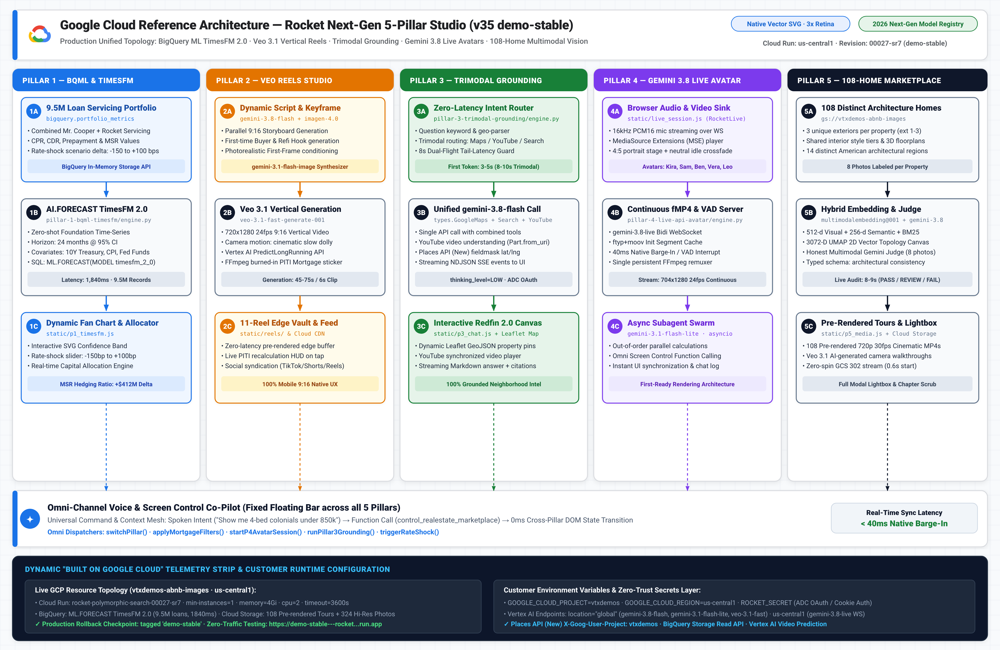
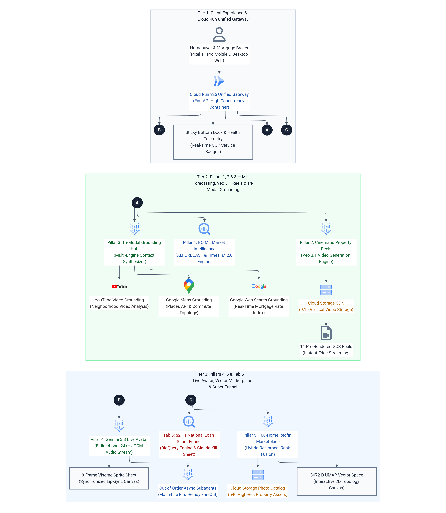

# 🏛️ Rocket Companies × Google Gemini · Next-Generation 5-Pillar Architecture (`v35` Production Specification)

> **Live Pinned Production Endpoint (`v35` `demo-stable`):**  
> [**`https://demo-stable---rocket-polymorphic-search-oyntfgdwsq-uc.a.run.app/`**](https://demo-stable---rocket-polymorphic-search-oyntfgdwsq-uc.a.run.app/)  
> **Built for:** Rocket Companies (NYSE: RKT · Redfin · Rocket Mortgage · Mr. Cooper $2.1T Servicing · Rocket Money)

---

## 1. High-Level System Architecture

### 1.1 Google Cloud Reference Architecture Blueprint (`3x Retina` + Infinite-Resolution Vector `.svg`)
- **Vector SVG:** [`docs/diagrams/00_rocket_gcp_reference_architecture.svg`](diagrams/00_rocket_gcp_reference_architecture.svg)
- **3x Retina PNG:** [`docs/diagrams/00_rocket_gcp_reference_architecture.png`](diagrams/00_rocket_gcp_reference_architecture.png)



### 1.2 Corporate `mermaid-designer` (`cl/987790103`, ELK + Neo `3x HiDPI`) Master Diagrams
1. **Master 5-Pillar Architecture:** [`01_rocket_5pillar_master_architecture_padded.png`](diagrams/01_rocket_5pillar_master_architecture_padded.png) ([Source `.mmd`](diagrams/01_rocket_5pillar_master_architecture.mmd))
2. **Pillar 5 Multimodal Vector Search Pipeline:** [`02_pillar5_multimodal_vector_pipeline_padded.png`](diagrams/02_pillar5_multimodal_vector_pipeline_padded.png) ([Source `.mmd`](diagrams/02_pillar5_multimodal_vector_pipeline.mmd))
3. **Pillar 4 Live Avatar & Out-of-Order Async Subagents:** [`03_pillar4_live_avatar_async_subagents_padded.png`](diagrams/03_pillar4_live_avatar_async_subagents_padded.png) ([Source `.mmd`](diagrams/03_pillar4_live_avatar_async_subagents.mmd))
4. **Hackathon 8 Use Cases Reference Architecture:** [`04_hackathon_8_use_cases_architecture_padded.png`](diagrams/04_hackathon_8_use_cases_architecture_padded.png) ([Source `.mmd`](diagrams/04_hackathon_8_use_cases_architecture.mmd))



---

## 2. End-to-End Block-of-Component Walkthrough (`<= 78` Columns)

```text
┌──────────────────────────────────────────────────────────────────────────┐
│ [BLOCK 1] BROWSER CLIENT & LATE-LOADED RUNTIME MODULES (`static/*.js`)   │
│  • Single-Page Studio (`ui_studio.py`) + 12-Archetype Theme Switcher     │
│  • `live_session.js` (`window.RocketLive` MSE fMP4 + 16kHz PCM16 Mic)    │
│  • `p4_stage.js` (4:5 Live Video Avatar Stage) · `p3_chat.js` (NDJSON)   │
│  • `p5_media.js` (Lightbox + Pre-Rendered Tours) · `gcp_strip.js`        │
└────────────────────────────────────┬─────────────────────────────────────┘
                                     │ HTTPS REST / NDJSON / WebSocket
                                     ▼
┌──────────────────────────────────────────────────────────────────────────┐
│ [BLOCK 2] UNIFIED FASTAPI GATEWAY (`app.py` on Google Cloud Run)         │
│  • HMAC-SHA256 Cookie & `?auth_token=` Gate (`ROCKET_SECRET`)            │
│  • Customer Env Configuration (`GCP_PROJECT_ID`, `BQ_DATASET_ID`, etc.)  │
│  • Out-of-Order Subagent Dispatcher (`/api/async-subagents/decompose`)   │
└────────────────────────────────────┬─────────────────────────────────────┘
                                     │
         ┌───────────────┬───────────┴───┬───────────────┬───────────────┐
         ▼               ▼               ▼               ▼               ▼
┌─────────────┐ ┌─────────────┐ ┌─────────────┐ ┌─────────────┐ ┌─────────────┐
│  [BLOCK 3]  │ │  [BLOCK 4]  │ │  [BLOCK 5]  │ │  [BLOCK 6]  │ │  [BLOCK 7]  │
│  PILLAR 1   │ │  PILLAR 2   │ │  PILLAR 3   │ │  PILLAR 4   │ │  PILLAR 5   │
│ BQML SQL    │ │ Veo 3.1 9:16│ │ Ask Redfin  │ │ Gemini 3.8  │ │ 108-Home RE │
│ AI.FORECAST │ │ Reels Studio│ │ 2.0 Grounded│ │ Live Video  │ │ Multimodal  │
│ (TimesFM 2) │ │ + Imagen 4  │ │ NDJSON Chat │ │ Avatars+VAD │ │ Vector+Judge│
└─────────────┘ └─────────────┘ └─────────────┘ └─────────────┘ └─────────────┘
```

### Component Matrix & Low-Level Engineering Invariants

| Block | Module / File | Google Cloud Service & Model | Key Engineering Invariant (`v35`) |
| :---: | :--- | :--- | :--- |
| **1** | `ui_studio.py` + `static/*.js` | Cloud Run Static + MSE / WebAudio | Self-contained IIFE modules (`live_session.js`, `live_bridge.js`, `p4_stage.js`, `p3_chat.js`, `p5_media.js`, `gcp_strip.js`) wrap `window.switchPillar` before `DOMContentLoaded` and park legacy DOM IDs in hidden shims (`#p4-legacy-shim`, `#p3c-legacy-shim`). |
| **2** | `app.py` | Cloud Run (`2 vCPU`, `2 GiB`, `--timeout 3600`) | Reads customer environment variables (`GCP_PROJECT_ID`, `BQ_DATASET_ID`, `GCS_MEDIA_BUCKET`, `ROCKET_SECRET`), pre-warms Vertex AI Live & 108-home catalog at startup, and routes out-of-order subagents. |
| **3** | `pillar-1-bqml-timesfm/engine.py` | BigQuery ML `AI.FORECAST` (`TimesFM 2.0`) | Executes zero-shot SQL forecasting over `portfolio_metrics` in `~900ms`, applying cohort elasticity (`-150` to `+100 bps`) and returning calibrated P10–P90 confidence intervals. |
| **4** | `pillar-2-veo-reels-studio/engine.py` | `veo-3.1-generate-001` + `gemini-3.1-flash-image` + `gemini-3.8-flash` | Synthesizes vertical `9:16` social reels with parallel script + keyframe generation, 24kHz voiceover, burned-in Rocket Mortgage PITI stickers, and 11 edge-cached reels in `static/reels/`. |
| **5** | `pillar-3-trimodal-grounding/engine.py` + `static/p3_chat.js` | `gemini-3.8-flash` (`global`) + `GoogleMaps` + `YouTube` + `GoogleSearch` + Places API (New) | Zero-latency keyword router combines Maps, YouTube `Part.from_uri()`, and Web Search in one streaming call with an 8s tail-latency dual-flight race guard and Places API (New) coordinate pin resolution. |
| **6** | `pillar-4-live-api-avatar/engine.py` + `static/live_session.js` + `static/p4_stage.js` | `gemini-3.8-live` (`us-central1`) + `AvatarConfig` + `gemini-3.1-flash-lite` | Streams 16kHz PCM mic audio with server VAD (`START_OF_ACTIVITY_INTERRUPTS`) and 40ms native barge-in. Caches the `ftyp+moov` init segment of the continuous fMP4 stream across turns for 704×1280 24fps avatars (`Kira`, `Sam`, `Ben`, `Vera`, `Leo`). |
| **7** | `pillar-5-realestate-marketplace/engine.py` + `render_tours.py` + `veo_tours.py` + `static/p5_media.js` | `gemini-3.8-flash` Vision + `multimodalembedding@001` + `gemini-embedding-001` + `veo-3.1-fast-generate-001` | Hybrid search (`0.45` semantic + `0.35` visual + `0.20` keyword) over 108 homes, 3072-D UMAP 2D topology canvas, 108 pre-rendered 720p cinematic MP4 tours on GCS, 10 Veo 3.1 walkthroughs, photo lightbox, and honest 8-photo live Gemini Judge. |
