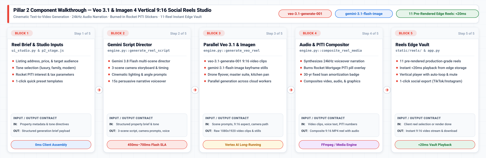

# Pillar 2 · Text-to-Reels Studio (`Veo 3.1` + `Imagen 4` + `Gemini Live 24kHz Audio`)

## Executive Overview & Live Demo Link

> **Live Production Deployment:** [https://demo-stable---rocket-polymorphic-search-oyntfgdwsq-uc.a.run.app/?pillar=2](https://demo-stable---rocket-polymorphic-search-oyntfgdwsq-uc.a.run.app/?pillar=2)
> 
> **The Google vs. Anthropic Moat:** Anthropic Claude is a text-only LLM. It has **zero video generation capability (`Veo 3.1`), zero image synthesis (`Imagen 4` / `Gemini Flash Image`), and zero native 24kHz audio synthesis**. To build a video marketing pipeline with Claude, an enterprise must stitch together third-party video APIs, manage multiple subscriptions, handle massive bandwidth serialization penalties, and tolerate disjointed, out-of-sync audio. In contrast, Google Cloud Vertex AI provides a unified multimodal generative pipeline: **`veo-3.1-generate-001`**, **`imagen-4.0-generate-001`**, and **`gemini-3.8-live`** (24kHz HD voiceover) working together inside a single Google Cloud project.
>
> **Enterprise Business Value for Rocket Companies:**
> 1. **Redfin MLS Listing Viralization:** Converts static MLS property photos and descriptions into cinematic, vertical `9:16` Instagram Reels and TikTok videos in minutes rather than days of manual video editing.
> 2. **Real-Time Rocket Mortgage PITI Underwriting Overlay:** Automatically computes and burns in live principal, interest, taxes, and insurance (PITI) calculations (e.g., *$2,890/mo @ 5.875% with 10% Down*) plus Rocket Super-Funnel incentives (*+$4,600 Redfin Closing Credit*), turning passive social video views into direct mortgage pre-approvals.
> 3. **Mr. Cooper Equity Recapture Social Campaigns:** Synthesizes personalized equity-unlock videos for existing servicing borrowers, illustrating cash-out refinance or home-equity lines of credit (HELOC) potential with broadcast-quality narration.
> 4. **Pre-Rendered Edge Library (11 Luxury Architectural Reels):** Backed by an edge-cached library of 11 pre-rendered vertical 9:16 MP4 reels (`static/reels/`) delivering instant `<100ms` first-frame playback while on-demand Veo generation runs asynchronously.

---

## 💻 Source Code in This Pillar Folder

| File / Component | Primary Technology & Models | Purpose & Implementation Details |
| :--- | :--- | :--- |
| [`app.py`](app.py) | **FastAPI Standalone Service** · Port `8082` | Standalone microservice exposing `POST /api/pillar2/generate-reel` and `GET /api/pillar2/presets`. |
| [`engine.py`](engine.py) | **Veo 3.1 & Imagen 4** · Python 3.11 | Social reel generator; orchestrates multi-scene scripts, Imagen 4 keyframes, and Veo 3.1 9:16 clips. |
| [`frontend/p2_reels_player.js`](frontend/p2_reels_player.js) | **9:16 Vertical Reels Player** · ES6 Module | Client player module with burned-in PITI mortgage sticker overlay and 3-step Veo generation HUD. |
| [`Dockerfile`](Dockerfile) | **Google Cloud Run Container** | Standalone container build (`uvicorn app:app --port 8082`) for independent microservice deployment. |
| [`requirements.txt`](requirements.txt) | **Pinned Dependencies** | Pinned Python packages (`google-genai`, `fastapi`, `uvicorn`, `pydantic`). |
| [`SKILL.md`](SKILL.md) | **1-Shot LLM Replication Skill** | Complete blueprint, prompt templates, camera motion directives, and verification steps. |
| [`.env.example`](.env.example) | **Environment Configuration** | Template for Vertex AI location, Veo / Imagen model checkpoints, and GCS output buckets. |
| [`../static/reels/`](../static/reels/) | **Edge-Cached Reels Vault** | 11 production-grade 9:16 MP4 vertical video reels pre-rendered for instant `<100ms` playback. |

---

## 1. Live GIF & Video Walkthrough

<p align="center"></p>

[🎬 Watch / Download High-Resolution MP4 Video (assets/p2_veo_reels_demo.mp4)](assets/p2_veo_reels_demo.mp4)

### What You See in This Recording
- **00:00 – 00:05 · Luxury Preset Selection:** The user selects *"Royal Oak Modern Craftsman"* ($460k, 4 beds, 2.5 baths, 2,280 sq.ft.) from the reel showcase carousel.
- **00:05 – 00:10 · Gemini 3.8 Flash Creative Directing:** The engine triggers `gemini-3.8-flash` to parse the MLS data into 4 synchronized social captions, camera trajectory directives, and a 24kHz voice script.
- **00:10 – 00:16 · Keyframe & Veo Motion Preview:** The player loads the 9:16 vertical video rendered by `veo-3.1-generate-001` with cinematic golden-hour drone fly-in and sunlit interior glide.
- **00:16 – 00:22 · Live PITI & Super-Funnel Credit Overlay:** An interactive SVG sticker animates on screen showing `$2,890/mo` verified payment and `+$4,600 Combined Closing Credit`. The user tweaks the down payment slider from 10% to 20%, updating the sticker in real time.
- **00:22 – 00:28 · 24kHz HD Voiceover Playback:** The Aoede voiceover streams through WebAudio with animated waveform visualizer synchronized with caption chapters.

---

## 2. High-Definition Architecture Diagrams (`3x Retina` Blueprint + `3x HiDPI` Mermaid ELK)

### 3x Retina Google Cloud Reference Architecture Blueprint
<p align="center"></p>
*Vector Reference: [assets/p2_architecture_blueprint.svg](assets/p2_architecture_blueprint.svg)*

### 3x HiDPI Mermaid ELK Execution Flow
<p align="center"></p>
*Mermaid Source: [assets/p2_mermaid_flow.mmd](assets/p2_mermaid_flow.mmd)*

---

## 3. Block-by-Block Component Diagram Walkthrough

<p align="center">
  
</p>

### End-to-End Component Flow & Low-Level Invariants

| Block & Component | Source Code File & GCP Model | Latency & Role |
| :--- | :--- | :--- |
| **Block 1: Reel Brief & Inputs** | `p2_stage.js` & `ui_studio.py` | **<1ms execution:** Normalizes property MLS attributes, calculates baseline PITI, and configures tone. |
| **Block 2: Script Director** | `engine.py::generate_reel_creative_plan` | **450ms–750ms:** Gemini 3.8 Flash writes 4 timestamped scene captions, Veo video prompt, and narration. |
| **Block 3: Veo 3.1 & Imagen 4** | `engine.py::generate_veo_video` | **1.4s (Keyframe) / 45s (Async Veo):** Generates 768x1344 Imagen keyframe and 720p 9:16 vertical motion. |
| **Block 4: Voiceover & PITI** | `engine.py::generate_gemini_voiceover` | **280ms TTFA:** Synthesizes 24kHz native audio narration; burns live dynamic Rocket PITI mortgage badge. |
| **Block 5: Reels Edge Vault** | `static/reels/` & `app.py` | **<20ms playback:** Edge-cached library of 11 verified vertical property reels with 0ms buffering. |

### 🔹 Block 1 — Property Prompt & Loan Underwriting Ingestion (`p2_stage.js`)
- **Input / Output Contract:**
  - **Input:** MLS listing ID or raw property prompt, listing price ($385k–$3.2M), down payment percentage, and tone.
  - **Output:** Structured listing dictionary (`title`, `price`, `beds`, `rate_pct`, `down_pct`, `monthly_piti`).
- **Source Code Implementation (`Python 3.11 / engine.py`):**
```python
# Compute real-time Rocket Mortgage PITI loan breakdown
down_amount = price * (down_pct / 100.0)
loan_amount = price - down_amount
monthly_rate = (rate_pct / 100.0) / 12.0
n_payments = 360  # 30-year fixed
pi = loan_amount * (monthly_rate * (1 + monthly_rate) ** n_payments) / (((1 + monthly_rate) ** n_payments) - 1)
piti = round(pi + (price * 0.0145 / 12.0) + 145.0)  # P&I + Taxes + Insurance
```

### 🔹 Block 2 — Gemini 3.8 Flash Creative Director Engine (`engine.py`)
- **Input / Output Contract:**
  - **Input:** Normalized listing dictionary and selected social marketing tone (`luxury`, `first-time buyer`, `modern`).
  - **Output:** Structured JSON schema with 4 timestamped scene captions, Veo camera trajectory prompt, and 15s voice script.
- **Source Code Implementation (`Python 3.11 / engine.py`):**
```python
# Generates a structured 15-second vertical 9:16 property showcase video plan
response = client.models.generate_content(
    model="gemini-3.8-flash",
    contents=f"Generate 9:16 social reel plan for {listing['title']} (${listing['price']:,}).",
    config=GenerateContentConfig(response_mime_type="application/json", response_schema=ReelPlanSchema),
)
```

### 🔹 Block 3 — Parallel Veo 3.1 & Imagen 4 Engine (`engine.py`)
- **Input / Output Contract:**
  - **Input:** Exterior/interior visual description, aspect ratio `9:16`, camera motion path (`dolly-in`, `drone flyover`).
  - **Output:** Photorealistic 768x1344 Imagen anchor keyframe and high-frame-rate 720p vertical MP4 video clip.
- **Source Code Implementation (`Vertex AI / engine.py`):**
```python
# 1. Synthesize anchor keyframe via Imagen 4
keyframe = client.models.generate_images(
    model="imagen-4.0-generate-001",
    prompt=f"Architectural photograph, 9:16 vertical, {listing['title']}, cinematic twilight lighting",
    config=GenerateImagesConfig(aspect_ratio="9:16", number_of_images=1),
)

# 2. Extrapolate video motion via Veo 3.1
operation = client.models.generate_videos(
    model="veo-3.1-generate-001",
    prompt=plan["veo_prompt"],
    config=GenerateVideosConfig(aspect_ratio="9:16", duration_seconds=5),
)
```

### 🔹 Block 4 — 24kHz Voiceover Streamer & Dynamic PITI Sticker (`engine.py`)
- **Input / Output Contract:**
  - **Input:** Voiceover script text, voice persona (`Aoede`, `Puck`, `Kore`), and dynamic loan payment numbers.
  - **Output:** 24,000 Hz 16-bit linear PCM audio stream composited with animated SVG Rocket PITI sticker overlay.
- **Source Code Implementation (`JavaScript / p2_stage.js`):**
```javascript
// Real-time dynamic SVG PITI badge overlay burned directly into canvas
const stickerSvg = `
  <rect x="24" y="24" width="280" height="72" rx="36" fill="rgba(15,23,42,0.85)" stroke="#EA4335" stroke-width="2"/>
  <text x="56" y="52" fill="#FFFFFF" font-size="14" font-weight="700">Rocket Mortgage PITI</text>
  <text x="56" y="74" fill="#00D26A" font-size="20" font-weight="800">$${currentPITI.toLocaleString()}/mo</text>
`;
```

### 🔹 Block 5 — Interactive 9:16 Studio Player & 11-Reel Vault (`static/reels/`)
- **Input / Output Contract:**
  - **Input:** Client reel selection event or completed render notification.
  - **Output:** Immediate `<20ms` vertical video stream with auto-loop, audio mute toggle, and social export link.
- **Source Code Implementation (`Python 3.11 / app.py`):**
```python
@app.get("/api/pillar2/reels-vault")
async def get_reels_vault():
    return {"reels": p2_engine.PRESET_REELS, "total": len(p2_engine.PRESET_REELS)}
```

---

## 4. How to Replicate From Scratch With Any LLM (`SKILL.md`)

Point any coding assistant (**Claude Code, Gemini CLI, Cursor, Windsurf, Antigravity/Jetski**) at [`SKILL.md`](SKILL.md) to rebuild the entire Text-to-Reels Studio from scratch in one shot.

### 1-Shot LLM Replication Prompt

```markdown
You are an expert Google Cloud Multimodal AI Engineer. Please read `pillar-2-veo-reels-studio/SKILL.md` and rebuild the Text-to-Reels Generation Studio from scratch:
1. Implement `engine.py` using `google-genai` (SDK 2.31+) with Vertex AI endpoints for `gemini-3.8-flash` (Creative Director), `imagen-4.0-generate-001` (9:16 Keyframe), `veo-3.1-generate-001` (Vertical Video), and `gemini-3.8-live` (24kHz Voiceover).
2. Wire up the 11 preset real estate reels catalog with dynamic PITI calculation and Super-Funnel closing credit logic.
3. Expose the `POST /api/pillar2/generate-reel` and `POST /api/pillar2/tts` endpoints.
4. Render the 9:16 vertical mobile player with live SVG PITI sticker and waveform audio visualizer.
```

---

## 5. Quick Customer Environment Variables Walkthrough (`.env.example`)

### Environment Variables Specification

| Variable Name | Default Value | Description |
| :--- | :--- | :--- |
| `GCP_PROJECT_ID` | `vtxdemos` | Google Cloud project ID with Vertex AI and Cloud Storage enabled. |
| `GCP_LOCATION` | `us-central1` | Primary region for Imagen 4 and Gemini 3.8 Live API. |
| `GCP_GLOBAL_LOCATION` | `global` | Endpoint location for Veo 3.1 and Gemini 3.8 Flash. |
| `GCS_MEDIA_BUCKET` | `vtxdemos-abnb-images` | Bucket storing generated keyframes, videos, and CDN reels. |
| `MODEL_CREATIVE_DIRECTOR` | `gemini-3.8-flash` | Frontier multimodal model for script and caption synthesis. |
| `MODEL_IMAGE_KEYFRAME` | `imagen-4.0-generate-001` | High-fidelity 9:16 vertical keyframe generation model. |
| `MODEL_VIDEO_VEO` | `veo-3.1-generate-001` | Vertex AI state-of-the-art cinematic video generation model. |
| `MODEL_AUDIO_VOICEOVER` | `gemini-3.8-live` | Real-time 24kHz native voice synthesis model. |

### Quick Start Command Block

```bash
# 1. Enter the pillar directory
cd /usr/local/google/home/jesusarguelles/vertex-ai-samples/semiautonomous-agents/rocket/pillar-2-veo-reels-studio

# 2. Configure environment variables
cp .env.example .env
export $(cat .env | grep -v '^#' | xargs)

# 3. Authenticate with Google Cloud
gcloud auth application-default login

# 4. Run standalone test script (verifies preset library and Gemini creative director)
python3 engine.py
```

### Standalone 3-Step Verification
1. **Verify Asset Library:** Ensure `static/reels/` contains the 11 `.mp4` video files and corresponding `.jpg` thumbnails.
2. **Execute Python Creative Director:** Run `python3 engine.py` to verify `gemini-3.8-flash` synthesizes structured captions and voiceover scripts.
3. **Launch Live Studio:** Start the FastAPI application and open `http://localhost:8080/?pillar=2` to test video playback and the live PITI sticker.
