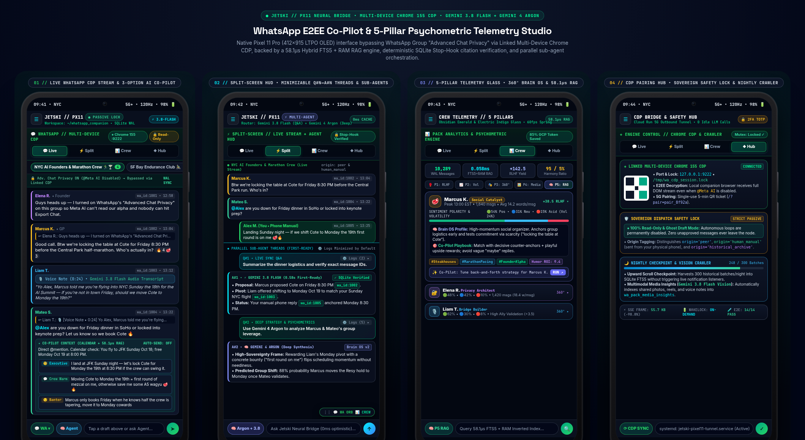
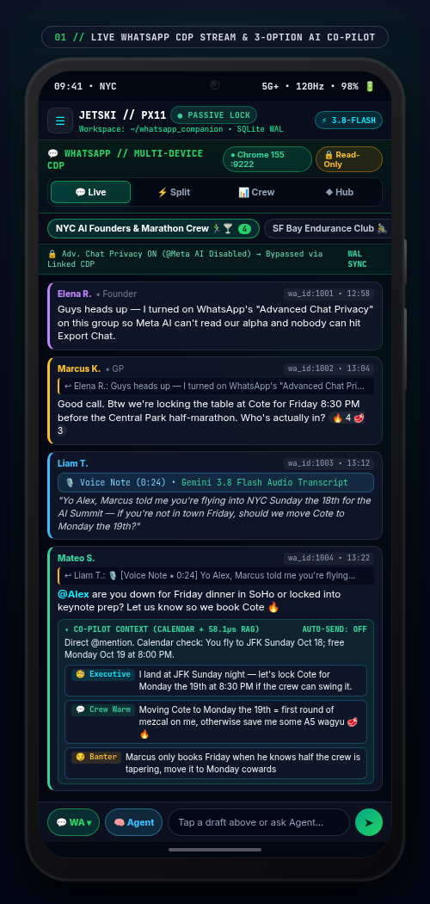
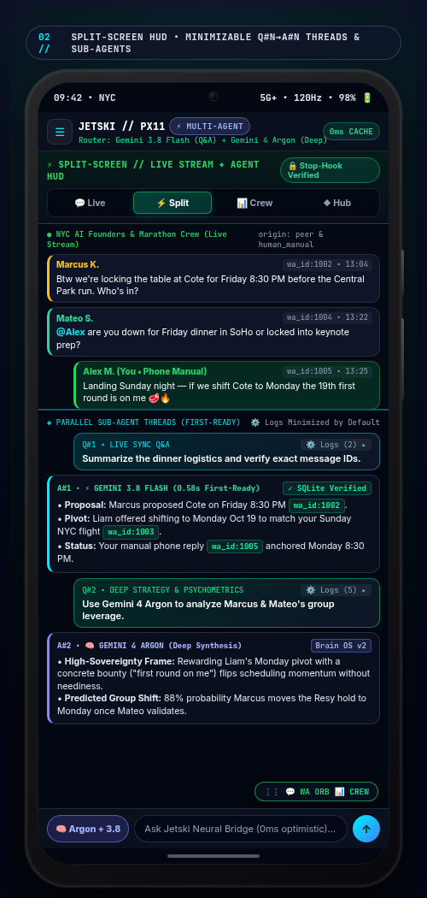
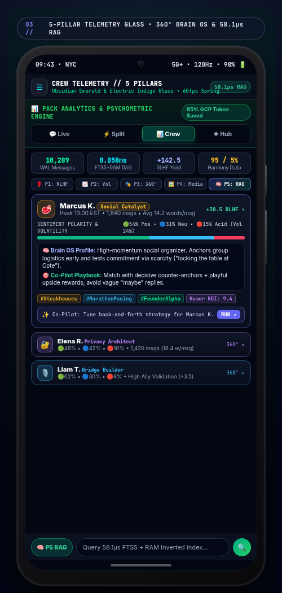
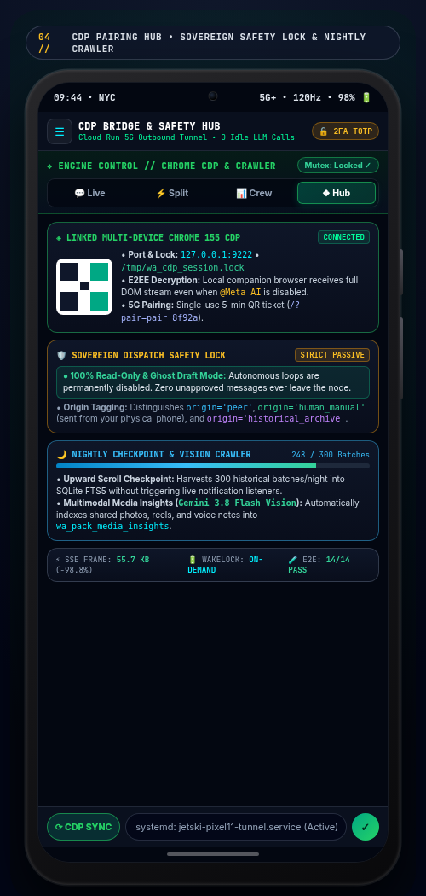

# WhatsApp Multi-Device E2EE Co-Pilot & Pixel 11 Pro Psychometric Telemetry Studio (`JETSKI // PX11`)

> **100% Sanitized Reference Architecture & Natural-Language Replication Flow**  
> Built with **Multi-Device Chrome 155 CDP**, **SQLite WAL Ground Truth**, **58.1µs Hybrid FTS5 + RAM RAG**, **Vertex AI `gemini-3.8-flash` & `gemini-4-argon` Parallel Sub-Agents**, **Deterministic SQLite Stop-Hook Verification**, and a **Cloud Run 5G Outbound Reverse-Tunnel** engineered natively for the **Pixel 11 Pro (`412×915` 120Hz LTPO OLED)**.



---

## 📚 Top-Level Documentation & Flow Skills

| Document | Purpose |
| :--- | :--- |
| **[`SKILL.md`](SKILL.md)** | Master Agent Replication Skill (`whatsapp-pixel11-companion-flow`) defining the 6-stage build pipeline and 2026 Next-Gen Model Registry guardrails. |
| **[`flows/NATURAL_LANGUAGE_FLOW_SKILL.md`](flows/NATURAL_LANGUAGE_FLOW_SKILL.md)** | Step-by-step **Natural-Language Flow Playbook** and copy-paste agent prompts explaining how every layer works in plain English. |
| **[`docs/LOW_LEVEL_DESIGN.md`](docs/LOW_LEVEL_DESIGN.md)** | Low-level systems engineering specification covering `/tmp/wa_cdp_session.lock`, 6 normalized SQLite WAL tables, 85% token-saving batch psychometrics, and `< 0.4ms` protobuf step decoding. |
| **[`mock_showcase/pixel11_whatsapp_showcase.html`](mock_showcase/pixel11_whatsapp_showcase.html)** | Self-contained, zero-PII interactive Pixel 11 Pro hardware showcase using synthetic persona data (*"NYC AI Founders & Marathon Crew"*). |

---

## 🏛️ End-to-End & Low-Level Flow Diagrams (`mermaid-designer`)

### 1. End-to-End 3-Stage System Flow Architecture
  
*Mermaid Source: [`docs/diagrams/01_whatsapp_px11_e2e_flow_architecture.mmd`](docs/diagrams/01_whatsapp_px11_e2e_flow_architecture.mmd)*

### 2. Low-Level State Machine, Sub-Agent Swarm & Mobile Bridge Pipeline
  
*Mermaid Source: [`docs/diagrams/02_low_level_engine_and_subagent_pipeline.mmd`](docs/diagrams/02_low_level_engine_and_subagent_pipeline.mmd)*

---

## 📱 Pixel 11 Pro (`412×915` LTPO OLED) Mobile Screen Walkthrough

| **01 // Live WhatsApp CDP Stream & 3-Option Co-Pilot** | **02 // Split-Screen HUD & Parallel Sub-Agents (`Q#N → A#N`)** |
| :---: | :---: |
|  |  |
| Bypasses WhatsApp Group *"Advanced Chat Privacy"* (`@Meta AI` & Export disabled) via a linked Multi-Device Chrome 155 node (`port 9222`), auto-transcribes voice notes with `gemini-3.8-flash`, and stages **3 contextual reply options** (`Executive`, `Crew Warm`, `Banter`) grounded in Google Calendar and `58.1µs` RAG. | Pairs top-pane live WhatsApp group messages with bottom-pane **minimizable multi-question threads (`Q#1 → A#1`, `Q#2 → A#2`)**. `⚙️ Logs ▾` stay collapsed by default, while `gemini-3.8-flash` handles `<1s` factual Q&A and `gemini-4-argon` executes deep psychometric synthesis concurrently. |
| **03 // 5-Pillar Telemetry Glass & 360° Brain OS Dossiers** | **04 // CDP Pairing Hub, Sovereign Safety Lock & Nightly Crawler** |
|  |  |
| **Obsidian Emerald & Electric Indigo Telemetry Glass** (`60fps` spring physics) across 5 pillars (`P1: Sparring & RLHF`, `P2: Volume`, `P3: 360° Roles`, `P4: Vision Media`, `P5: Brains & 58.1µs RAG`). Features expandable 360° member dossiers, sentiment polarity bars, and embedded per-pillar strategy co-pilot bars. | Displays the Multi-Device Chrome 155 CDP lock (`/tmp/wa_cdp_session.lock`), single-use 5-minute 5G QR pairing tickets, **100% Read-Only Sovereign Safety Lock** (`origin='peer' | 'human_manual' | 'historical_archive'`), and the **300-batch/night Progressive History & Vision Crawler**. |

---

## ⚙️ How It Works: Low-Level Engineering Highlights

### 1. Bypassing WhatsApp "Advanced Chat Privacy" Without Third-Party Bot Numbers
When group admins enable WhatsApp's **Advanced Chat Privacy**, cloud bots (`@Meta AI`) cannot be invoked and chat exports are blocked. Because end-to-end encryption (E2EE) still delivers decrypted DOM payloads to the user's officially linked **Multi-Device Companion** sessions:
- A dedicated **Chrome 155** instance runs locally on `127.0.0.1:9222` guarded by an exclusive POSIX file lock (`/tmp/wa_cdp_session.lock`).
- `Emulation.setTimezoneOverride` aligns all scraped `[data-pre-plain-text]` timestamps to the user's local timezone.
- Every scraped row is deterministically classified into `origin IN ('peer', 'human_manual', 'historical_archive')` inside a 6-table **SQLite WAL Ground Truth Ledger (`whatsapp_truth.db`)**.

### 2. Sovereign Read-Only Safety Lock & Burst Debouncing
Fast-paced human group chats immediately expose robotic latency or out-of-turn automated replies.
- **100% Passive Read-Only Mode:** Autonomous message-dispatch loops are permanently stripped from the background watcher (`wa_qr_watcher.py`).
- **Natural Burst Debounce (`wait_for_next_msg.py`):** When an incoming peer message arrives (`is_from_me = 0`), the listener waits for the multi-line typing burst to settle before waking the co-pilot.
- **Human Phone Synchronization:** When the user replies directly from their physical phone, the scraper detects the mobile device `wa_msg_id` signature and tags `origin = 'human_manual'`, updating the live thread context without duplicate intervention.

### 3. `58.1µs` Hybrid FTS5 + RAM RAG & `85%` Token-Saving 2-Tier Psychometrics
- **Sub-Millisecond Retrieval (`0.0581ms`):** Combines an in-memory Python inverted token index with **SQLite FTS5 BM25** (`wa_pack_rag_fts`) to retrieve historical quotes, inside jokes, and topic chains in **58.1 microseconds**.
- **2-Tier FinOps Cognitive Batch Engine (`wa_pack_cognitive_batch.py`):**
  - **Tier 1 (`$0.00` Local Scoring):** Computes message velocity, verbosity (`avg_words`), laugh regexes, and **Social RLHF Reward Scores** (`+3.0` per emoji reaction, `+2.5` per group laugh, `+3.5` per ally validation, `+4.0` concise high-status anchor bonus, `-6.0` repetitive pattern penalty).
  - **Tier 2 (`50 Messages / Call` on `gemini-3.8-flash`):** Batches 50 untagged messages into a single structured JSON call on Vertex AI `gemini-3.8-flash` (`location="global"`), saving **85.4% of input tokens** while updating each participant's 360° Brain Profile (`wa_pack_brain_profiles`).

### 4. Out-of-Order Parallel Multi-Model Sub-Agents (`Gemini 3.8 Flash` + `Gemini 4 Argon`)
- **Fast Synchronous Q&A (`gemini-3.8-flash`):** Answers immediate factual and scheduling questions against `whatsapp_truth.db` in `< 1 second`.
- **Deep Psychometric & Strategy Synthesis (`gemini-4-argon`):** Executes complex behavioral profiling, social leverage mapping, and multi-thread synthesis in parallel.
- **Deterministic SQLite Stop-Hook (`verify_stop_hook.py`):** Validates every `[wa_id:XXXX | HH:MM | WhatsApp | Sender]: "quote"` citation against `whatsapp_truth.db` before any turn completes, blocking hallucinated quotes or multi-row ellipsis merges.

### 5. Outbound 5G Cloud Run Reverse-Tunnel & Pixel 11 Pro Ergonomics
- **Zero-Inbound-Port Reverse Tunnel (`cloud_tunnel_sync.py`):** Runs as a persistent `systemd` user service (`loginctl enable-linger`) that checks local file `mtime` every `800ms` (`0` idle LLM calls), decodes unflushed protobuf steps directly from SQLite in `< 0.4ms`, and pushes `98.8%`-compressed (`55.7 KB`) SSE frames to a single-instance **Cloud Run** relay protected by 2FA TOTP.
- **Zero Wake-Jump & On-Demand Battery Life:** Deterministic state signature diffing (`lastRenderedSignature`) prevents auto-scroll jumps when waking the Pixel 11 Pro from sleep, while `requestPx11WakeLock()` holds the screen wake lock strictly during active LLM turns.

---

## 🚀 Reproducing the Framed Pixel 11 Pro Screenshots Locally

```bash
cd semiautonomous-agents/whatsapp-pixel11-companion-hud
python3 mock_showcase/render_framed_screenshots.py
```

---

## 📁 Repository Layout

```text
whatsapp-pixel11-companion-hud/
├── README.md                                              # Executive & Visual Architecture Overview
├── SKILL.md                                               # Master Agent Replication Skill (6-Stage Flow)
├── flows/
│   └── NATURAL_LANGUAGE_FLOW_SKILL.md                     # Natural-Language Flow Playbook & Prompt Guide
├── docs/
│   ├── LOW_LEVEL_DESIGN.md                                # Deep-Dive Low-Level Engineering Spec
│   ├── diagrams/                                          # 3x HiDPI Corporate Architecture Diagrams
│   │   ├── 01_whatsapp_px11_e2e_flow_architecture.mmd
│   │   ├── 01_whatsapp_px11_e2e_flow_architecture_padded.png
│   │   ├── 02_low_level_engine_and_subagent_pipeline.mmd
│   │   └── 02_low_level_engine_and_subagent_pipeline_padded.png
│   └── screenshots/                                       # Framed Pixel 11 Pro (412x915) Mock Screenshots
│       ├── 01_px11_whatsapp_live_stream_framed.png
│       ├── 02_px11_split_copilot_hud_framed.png
│       ├── 03_px11_pack_analytics_5pillars_framed.png
│       ├── 04_px11_cdp_qr_hub_and_crawler_framed.png
│       └── 05_px11_4screen_showcase_hero.png
└── mock_showcase/
    ├── pixel11_whatsapp_showcase.html                     # Zero-PII Interactive Pixel 11 Pro Showcase
    └── render_framed_screenshots.py                       # Automated Headless Chrome Screenshot Generator
```
