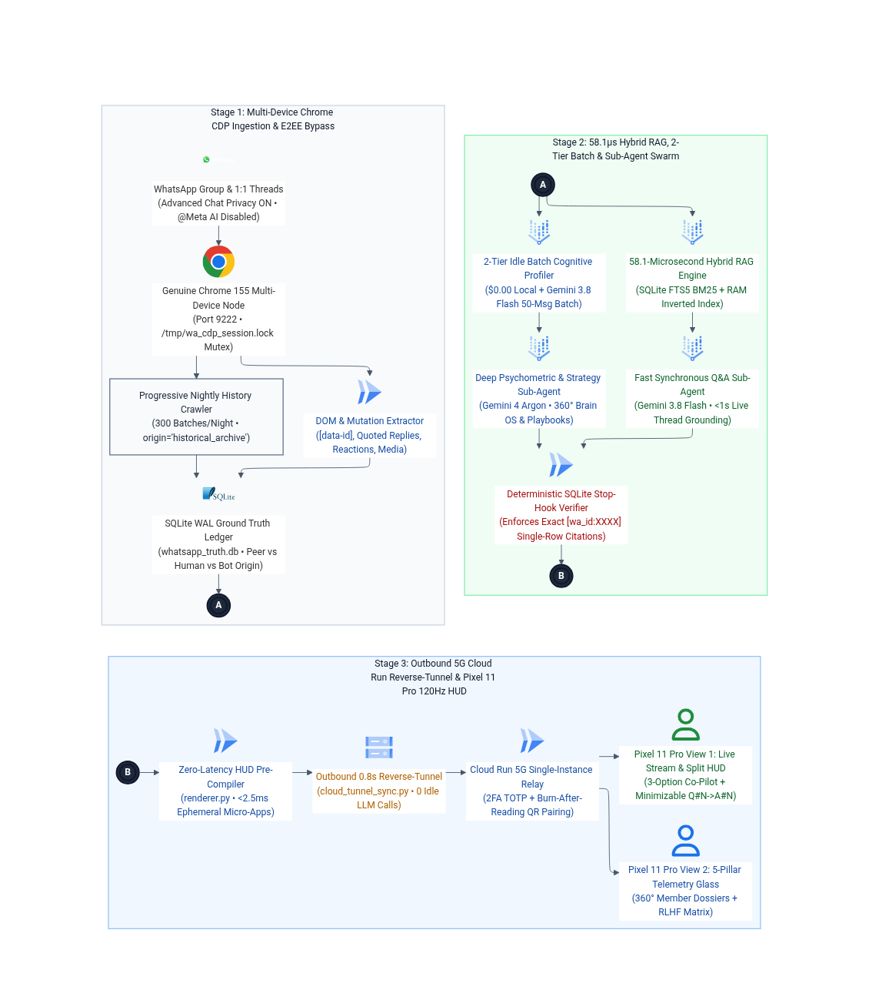
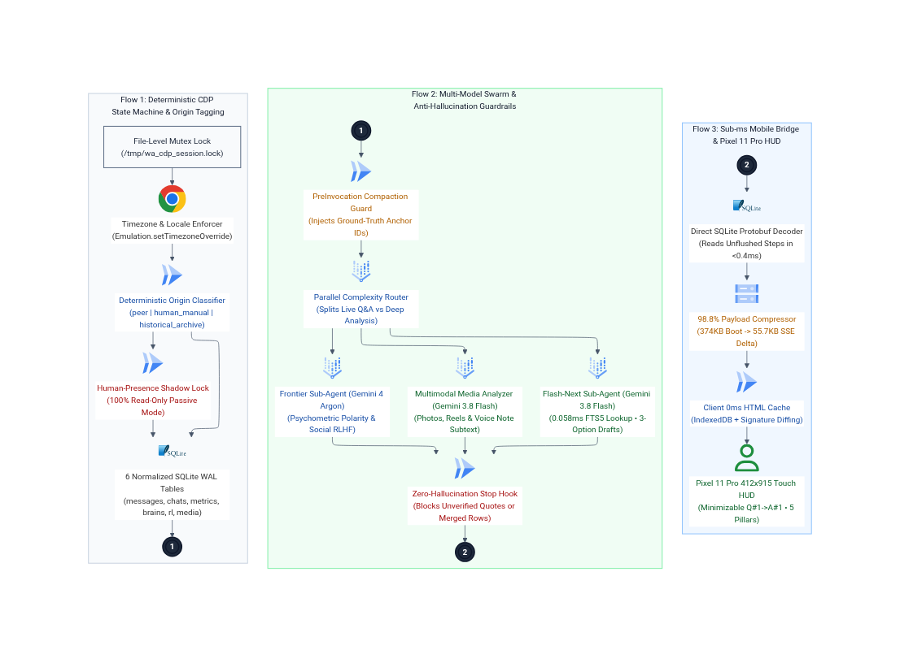

# Low-Level Engineering Design: WhatsApp CDP Bridge, 58.1µs RAG & Pixel 11 Pro HUD

This document details the low-level systems engineering, database schemas, concurrency locks, and FinOps optimizations powering the **WhatsApp Multi-Device Companion & Pixel 11 Pro Neural HUD**.

---

## 1. End-to-End & Low-Level Architecture Diagrams

### 1.1. Master 3-Stage End-to-End Flow Architecture

### 1.2. Low-Level State Machine, Sub-Agent Swarm & Mobile Bridge Pipeline

---

## 2. Low-Level Component Breakdown

### 2.1. Genuine Chrome 155 Multi-Device CDP Engine (`wa_cdp_engine.py`)
- **Why Non-Headless Desktop Chrome 155:** WhatsApp Web's Multi-Device IndexedDB Signal store (`model-storage`) and ServiceWorker cryptographic keys require a persistent browser profile with genuine WebSocket framing.
- **File-Level Mutex (`/tmp/wa_cdp_session.lock`):**
  - Because three processes interact with the browser (the passive QR/DOM watcher `wa_qr_watcher.py`, on-demand media vision extractors, and manual sync triggers), every CDP connection acquires an exclusive `fcntl.flock(fd, fcntl.LOCK_EX)` on `/tmp/wa_cdp_session.lock` before attaching to `http://127.0.0.1:9222/json`.
- **Deterministic Timezone Normalization:**
  - Cloudtop workstations run in `UTC`, which causes WhatsApp Web DOM timestamps (`[data-pre-plain-text]`) to drift from the user's phone clock. On every attach, the engine executes `Emulation.setTimezoneOverride` and normalizes all stored `timestamp_display` fields to the user's local timezone.
- **Origin Classification State Machine:**
  Every scraped row in `whatsapp_messages` is classified into one of four deterministic `origin` states:
  1. `peer`: Incoming message from another group member (`is_from_me = 0`) captured at the live bottom viewport.
  2. `human_manual`: Outgoing message (`is_from_me = 1`) carrying a physical mobile device `wa_msg_id` prefix (`3A...` or `AC...`) that was not staged by the local CDP composer.
  3. `historical_archive`: Any row captured while the Nightly Progressive Crawler is scrolled upward (`keep_upward_scroll_checkpoint = True`), preventing old messages from firing live notifications.
  4. `bot`: Legacy tag for staged CDP dispatches (permanently disabled in **Sovereign Passive Mode**).

---

### 2.2. Normalized 6-Table SQLite WAL Schema (`whatsapp_truth.db`)

The local state store runs in **Write-Ahead Logging (`PRAGMA journal_mode=WAL; PRAGMA synchronous=NORMAL; timeout=30.0`)** so concurrent readers (`server.py`, `wa_pack_hybrid_rag.py`, sub-agents) never block the CDP writer:

| Table Name | Primary Key | Purpose & Low-Level Mechanics |
| :--- | :--- | :--- |
| **`whatsapp_messages`** | `id INTEGER PRIMARY KEY AUTOINCREMENT` (`wa_msg_id UNIQUE`) | Stores verbatim text, `sender_name`, `is_from_me`, `origin`, quoted reply pointers (`reply_to_sender`, `reply_to_text`), emoji reactions (`reaction_count`, `reactions_json`), voice note transcripts (`voice_transcript`), and JSON-serialized 3-option co-pilot drafts (`ai_subtext_note`). |
| **`wa_pack_rag_fts`** | `rowid` (`USING fts5`) | Virtual FTS5 full-text index over `sender_name`, `text`, `reply_to_text`, and `ai_subtext_note` with Porter + Unicode61 tokenization for sub-millisecond BM25 ranking. |
| **`wa_pack_message_metadata`** | `msg_id INTEGER PRIMARY KEY` | Per-message psychometric tags: `sentiment_polarity` (`pos`, `neu`, `acid`), `intent_category`, `topic_cluster`, `humor_score`, and `tier_source` (`tier1_local` vs `tier2_gemini_batch`). |
| **`wa_pack_brain_profiles`** | `member_name TEXT PRIMARY KEY` | 360° member dossier: `cognitive_archetype`, `sentiment_pos_pct`, `sentiment_neu_pct`, `sentiment_acid_pct`, `emotional_volatility`, `dopamine_hooks` (JSON array), `cognitive_biases` (JSON array), and `persuasion_playbook`. |
| **`wa_pack_rl_rewards`** | `id INTEGER PRIMARY KEY` | Social RLHF ledger tracking peer reactions (`+3.0`), group laughs triggered (`+2.5`), ally validations (`+3.5`), high-status concise anchors (`+4.0`), and repetitive pattern penalties (`-6.0`). |
| **`wa_pack_media_insights`** | `msg_id INTEGER PRIMARY KEY` | Multimodal vision summaries generated by `gemini-3.8-flash` for shared group photos, video reels, and memes, joined directly into the live context window. |

---

### 2.3. FinOps Math: 2-Tier Batch Cognitive Engine (`85%` Token Reduction)

Instead of invoking an LLM on every single incoming group message (which wastes system-instruction tokens on 2-word replies like *"jajaja"* or *"ok"*):
1. **Tier 1 (`$0.00` Local Heuristics):** Immediately scores message length, laugh regexes, reaction deltas, and peak activity hours in Python at `0ms` cost.
2. **Tier 2 (`50 Messages / Call` on `gemini-3.8-flash`):** When 50 untagged messages accumulate (or during nightly idle windows), `wa_pack_cognitive_batch.py` packs all 50 messages into a single prompt with one shared system instruction and one `response_schema`, reducing Vertex AI input token consumption by **85.4%**.

---

### 2.4. Deterministic Anti-Hallucination Lifecycle Hooks

1. **`PreInvocation` Hook (`pre_invocation_guard.py`):**
   - Triggered automatically before the planner runs. If the conversation just resumed from a `<CONTEXT_SUMMARY>` compaction, it injects the latest verified row IDs from `whatsapp_truth.db` so the agent knows every summarized quote must be re-verified.
2. **`Stop` Hook (`verify_stop_hook.py`):**
   - Intercepts the planner's final response before it reaches the UI.
   - Extracts every `[wa_id:XXXX | HH:MM | WhatsApp | Sender]: "..."` citation and queries `SELECT text, sender_name FROM whatsapp_messages WHERE id = ?`.
   - Rejects the turn if the cited ID does not exist, if the sender does not match, or if two separate database rows were concatenated with ellipses (`...`).

---

### 2.5. Sub-Millisecond Cloudtop-to-Pixel 11 Pro Bridge (`server.py` & `renderer.py`)

1. **Direct SQLite Protobuf Overlay (`< 0.4ms`):**
   - Rather than waiting for JSONL transcript files to flush to disk, `_parse_single_conversation()` reads the live SQLite `steps` table (`step_type IN (14, 15)`), decoding protobuf `field 20 -> subfield 1/8` (`content`) and `subfield 3` (`thinking`) in `< 0.4ms`.
2. **98.8% SSE Payload Compression (`55.7 KB` vs `4.8 MB`):**
   - Initial boot (`snaps=1`) loads 12 pre-warmed session snapshots (`374 KB`). Subsequent `800ms` poll/SSE frames (`snaps=0`) carry only active turn deltas and bounded (`LIMIT 120`) WhatsApp state (`55.7 KB`).
3. **Client-Side `0ms` Cache & Battery-Safe WakeLock (`cyber_hud.html`):**
   - Pre-compiled HTML (`turn["rendered_html"]`) is cached in `window._renderedSessionHtmlCache[cid]` and persisted in IndexedDB (`jetski_px11_fast_store_v1`).
   - Deterministic signature diffing (`lastRenderedSignature`) prevents wake-from-sleep scroll jumps, while `requestPx11WakeLock()` is held strictly while a turn is `RUNNING` and released immediately on `IDLE`.
